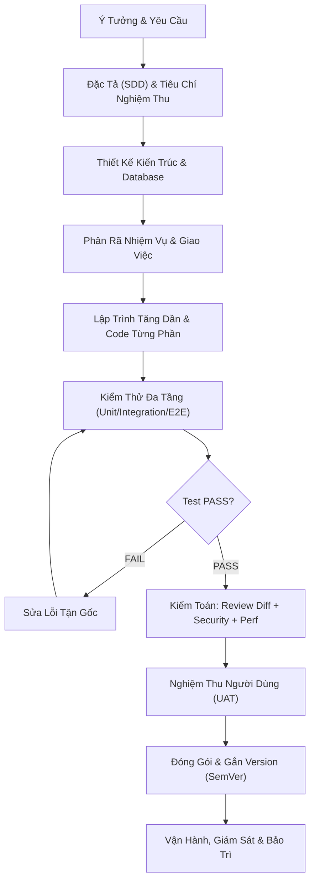

# DEX End-to-End AI Software Engineering Playbook

## 1. Triết Lý Vận Hành Tổng Thể
Playbook này là kim chỉ nam toàn diện kết nối 30 kỹ năng thành một guồng máy phát triển phần mềm nhịp nhàng, có tính kỷ luật cao và loại bỏ hoàn toàn tính bất định của AI.

Sơ đồ dòng chảy tổng thể:

---

## 2. Checklists Chi Tiết Cho 10 Giai Đoạn

### Giai đoạn 1: Discovery & Context
- [ ] Khảo sát công nghệ, môi trường và cấu trúc hiện tại.
- [ ] Thiết lập tài liệu `AGENTS.md` và `README.md`.
- [ ] Phân định rõ những gì đã có và những gì cần làm mới.

### Giai đoạn 2: Specification (SDD)
- [ ] Soạn thảo `SPEC.md` với các kịch bản người dùng cụ thể.
- [ ] Định nghĩa 100% Acceptance Criteria theo chuẩn Given-When-Then.
- [ ] Liệt kê danh sách các trường hợp ngoại lệ và dữ liệu biên.

### Giai đoạn 3: Architecture & Data
- [ ] Chọn mô hình Modular Monolith, tách biệt Domain, Application và Infrastructure.
- [ ] Lập bản ghi ADR cho các quyết định cốt lõi.
- [ ] Viết migration DB hai chiều UP/DOWN an toàn.

### Giai đoạn 4: Task Delegation
- [ ] Lập file `TASKS.md` với các task nhỏ độc lập.
- [ ] Gán rõ phạm vi file được phép sửa cho từng task.
- [ ] Thiết lập thứ tự phụ thuộc giữa các task.

### Giai đoạn 5: Incremental Implementation
- [ ] Tuân thủ: Chia nhỏ → Viết code → Kiểm tra → Sửa lỗi → Ổn định → Git.
- [ ] Không nâng cấp khi phần hiện tại chưa chạy ổn định.
- [ ] Giữ code đơn giản, áp dụng KISS và YAGNI.

### Giai đoạn 6: Testing & Debugging
- [ ] Viết test trước hoặc song song với code.
- [ ] Tái hiện lỗi bằng failing test trước khi sửa.
- [ ] Đảm bảo 100% test suite đạt PASS.

### Giai đoạn 7: Quality Engineering (Audit & Review)
- [ ] Rà soát từng dòng Git Diff (`git diff`).
- [ ] Quét bảo mật OWASP Top 10 và quét secrets.
- [ ] Đo lường số liệu hiệu năng (p95 latency, RPS) có benchmark trước/sau.

### Giai đoạn 8: User Acceptance (UAT) & UX
- [ ] Chạy thử nghiệm hành trình người dùng thực tế trên môi trường Staging.
- [ ] Kiểm tra responsive trên mobile/desktop.
- [ ] Kiểm tra khả năng điều hướng bàn phím và WCAG a11y.

### Giai đoạn 9: Release & Delivery
- [ ] Nâng version SemVer (`MAJOR.MINOR.PATCH`).
- [ ] Cập nhật `CHANGELOG.md` đầy đủ.
- [ ] Tạo Git tag có chú thích và thiết lập phương án rollback trong 5 phút.

### Giai đoạn 10: Operations & Evolution
- [ ] Kiểm tra `/healthz` liveness & readiness endpoints.
- [ ] Cấu hình Structured JSON Logging với trace ID.
- [ ] Theo dõi cảnh báo và lập kế hoạch bảo trì định kỳ.
