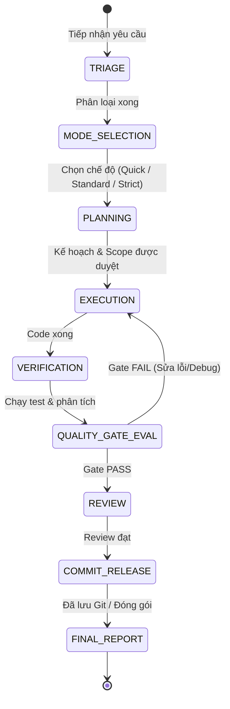

# Orchestration Protocol & State Transition Specification

## 1. Giới thiệu
Tài liệu này định nghĩa giao thức điều phối và vòng đời chuyển trạng thái của **Master Orchestrator** trong DEX Engineering Skills Pack v1.0.

Mỗi nhiệm vụ kỹ thuật khi đưa vào hệ thống sẽ chuyển giao qua một máy trạng thái hữu hạn (Finite State Machine) nghiêm ngặt nhằm đảm bảo tính toàn vẹn, ngăn ngừa lỗi hồi quy và duy trì chất lượng cao nhất.

---

## 2. Finite State Machine (FSM)



---

## 3. Các Trạng thái Chi tiết

### S1: TRIAGE (Tiếp nhận & Phân loại)
- **Mục tiêu**: Xác định bản chất của yêu cầu (Bug, Feature, Refactor, Performance, Security, Release, Setup).
- **Hành động**:
  - Quét ngữ cảnh dự án hiện hữu (`README.md`, `package.json`, cấu trúc thư mục, git status).
  - Xác định "Blast Radius" (bán kính ảnh hưởng).
- **Đầu ra**: Bản tóm tắt yêu cầu và phạm vi dự kiến.

### S2: MODE_SELECTION (Chọn Chế độ)
- **Mục tiêu**: Quyết định độ sâu của quy trình kiểm soát (QUICK, STANDARD, STRICT).
- **Tiêu chí**:
  - File chạm vào <= 2 files, không đổi DB/API/Auth -> **QUICK**.
  - Logic tính năng mới, refactor vừa, thay đổi flow người dùng -> **STANDARD**.
  - DB schema, bảo mật/auth, kiến trúc lõi, release production -> **STRICT**.

### S3: PLANNING & SPECIFICATION
- **Mục tiêu**: Xác định rõ CẦN LÀM GÌ, KHÔNG LÀM GÌ, và KHI NÀO HOÀN THÀNH.
- **Áp dụng**: Bắt buộc với STANDARD và STRICT. (QUICK có thể tóm tắt ngắn).
- **Gate kiểm tra**: `QG-01 (Scope Defined)`, `QG-02 (Spec Compliant)`.

### S4: EXECUTION (Triển khai kỹ thuật)
- **Mục tiêu**: Viết code, tái cấu trúc hoặc sửa lỗi trong đúng phạm vi được giao.
- **Ràng buộc**:
  - Không sửa file ngoài phạm vi.
  - Tuân thủ coding style và quy ước hiện hữu của dự án.
  - Thêm test tương ứng cho phần code mới/sửa.

### S5: VERIFICATION & QUALITY GATE EVALUATION
- **Mục tiêu**: Thu thập bằng chứng thực tế chứng minh code hoạt động đúng.
- **Hành động**:
  - Chạy linter / typechecker (`QG-03`).
  - Chạy build script (`QG-04`).
  - Chạy unit / integration tests (`QG-05`).
  - Đánh giá hồi quy (`QG-06`).
  - Quét secrets và bảo mật (`QG-07`).
- **Xử lý rẽ nhánh**:
  - Nếu bất kỳ gate nào FAIL: chuyển trạng thái về `EXECUTION` kèm thông báo lỗi cụ thể để sửa.
  - Không cho phép đi tiếp khi chưa giải quyết gate rớt.

### S6: REVIEW & AUDIT
- **Mục tiêu**: Rà soát Git diff trước khi chốt.
- **Hành động**: `git diff` được kiểm tra từng dòng, đảm bảo không có debug log sót lại, không có file thừa.

### S7: COMMIT & RELEASE
- **Mục tiêu**: Lưu trạng thái an toàn vào Git hoặc phát hành.
- **Hành động**: Tạo commit message chuẩn mực (Conventional Commits), gắn tag phiên bản nếu là release.

### S8: FINAL_REPORT
- **Mục tiêu**: Báo cáo minh bạch toàn bộ quá trình, kết quả và bằng chứng kiểm thử cho người dùng.

---

## 4. Giao thức Truyền thông Điệp giữa các Skills
Khi Master Orchestrator chuyển giao nhiệm vụ cho một Skill chuyên biệt, ngữ cảnh chuyển giao phải có cấu trúc:

```yaml
Handoff_Payload:
  task_id: "DEX-TASK-XXXX"
  target_skill: "dex-root-cause-debugging"
  execution_mode: "STANDARD"
  scope:
    allowed_files: ["src/services/coupon.ts", "tests/coupon.test.ts"]
    forbidden_files: ["src/database/**"]
  acceptance_criteria:
    - "Test case test_coupon_20_percent_discount chuyển sang PASS"
    - "Tất cả 15 test cases cũ trong coupon.test.ts tiếp tục PASS"
  expected_gate_verifications: ["QG-01", "QG-02", "QG-05", "QG-06"]
```
