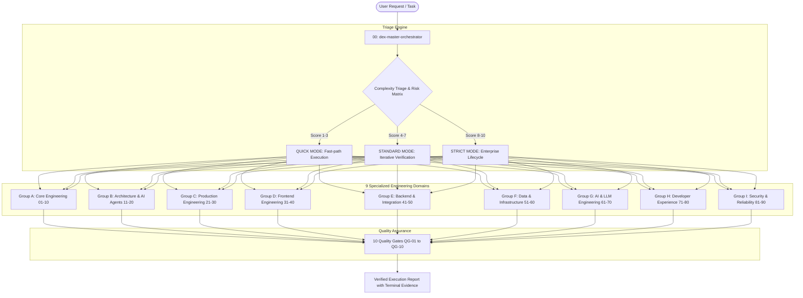

# DEX Engineering Skills Pack v3.0 — Technical Architecture

## 1. Architectural Mission & Overview

**DEX Engineering Skills Pack v3.0** is an enterprise-grade, deterministic AI Agent Skills Framework comprising **90 specialized engineering skills + 1 Master Orchestrator (91 skills total)**.

Designed for modern AI coding agents (specifically **OpenAI Codex**, **Cursor**, **Windsurf**, and **VS Code**), this system converts high-level user intentions into modular, strictly verified software engineering workflows without hallucinated completions or unverified claims.

---

## 2. Master Orchestrator (`dex-master-orchestrator`)

The Master Orchestrator serves as the central control plane. It enforces the immutable lifecycle:
`Analyze → Specify → Plan → Implement → Verify → Debug → Stabilize → Review → Commit → Release → Maintain`

### Execution Modes
1. **QUICK MODE (Risk Score 1–3)**:
   - For localized typo fixes, single-line bug fixes, documentation typos, or config tweaks.
   - Activates: `dex-development-workflow` + `dex-code-verification`.
   - Quality Gates: QG-01, QG-03, QG-04.
2. **STANDARD MODE (Risk Score 4–7)**:
   - For standard feature additions, API endpoints, bug investigations, and refactoring.
   - Activates: Scoped group of 3–5 specialized skills on a dedicated Git branch.
   - Quality Gates: QG-01 through QG-06, QG-09, QG-10.
3. **STRICT MODE (Risk Score 8–10)**:
   - For database schema migrations, authentication/authorization overhauls, payment logic, and releases.
   - Activates: Full orchestration with architectural review, threat modeling, chaos verification, and rollback plans.
   - Quality Gates: All 10 Quality Gates (QG-01 through QG-10) enforced with zero waivers.

---

## 3. The 10 Quality Gates (QG-01 to QG-10)

Every task executed under the DEX framework must clear the mandatory quality gates:

| Gate | Name | Technical Enforcement & Verification Criteria |
|:---|:---|:---|
| **QG-01** | Specification & Input Contract | Clear goal, defined input/output boundaries, acceptance criteria documented. |
| **QG-02** | Decomposition & Blast Radius | Task split into bite-sized steps; blast radius mapped before modifying code. |
| **QG-03** | Code Quality & Type Safety | Zero linter warnings (`--max-warnings 0`), 100% strict type checking. |
| **QG-04** | Automated Verification | Real terminal execution of tests; zero skipped tests; no mocked falsified passes. |
| **QG-05** | Root-Cause Defect Elimination | Defect reproduced by a failing test first; underlying defect eliminated. |
| **QG-06** | Schema & Contract Compatibility | Zero unapproved breaking changes via schema diffing; backward compatibility intact. |
| **QG-07** | Resilience & Error Handling | Timeouts, exponential backoff retries, and circuit breaker fallbacks in place. |
| **QG-08** | Performance & Resource Budget | Execution within latency/memory budgets; query execution plans inspected. |
| **QG-09** | Security & Tenancy Isolation | Zero hardcoded credentials, SAST audit passed, tenant isolation verified via RLS. |
| **QG-10** | Evidence-Based Delivery | Full command output and verifiable proof provided; release changelog updated. |

---

## 4. Skills Taxonomy: 9 Specialized Engineering Groups

1. **Group A: Core Engineering (01–10)**: Fundamental Vibe Coding loops, task delegation, verification, git safety, modularity, profiling, and security auditing.
2. **Group B: Software Architecture & AI Agents (11–20)**: Production observability, refactoring, Clean Architecture, schema migrations, and autonomous agent governance.
3. **Group C: Production Engineering (21–30)**: Blast radius calculation, dependency management, resilience patterns, race conditions, WCAG accessibility, and full-lifecycle delivery.
4. **Group D: Frontend Engineering (31–40)**: UI component contracts, design system tokens, state normalization, client routing, Web Vitals, SSR/SEO, and visual regression.
5. **Group E: Backend & Integration (41–50)**: Domain-Driven Design, async worker queues, distributed caching, WebSockets/SSE, search indexing, and event streaming.
6. **Group F: Data & Infrastructure (51–60)**: Data contracts, batch/streaming ETL, Great Expectations quality suites, schema evolution, query plans, and disaster recovery.
7. **Group G: AI & LLM Engineering (61–70)**: LLM integration, RAG vector pipelines, retrieval metrics (RAGAS), prompt evaluation, tool calling contracts, and cost controls.
8. **Group H: Developer Experience & Platform (71–80)**: Repository bootstrapping, monorepo governance, CLI engineering, cross-platform portability, WinGet/MSIX, and SemVer automation.
9. **Group I: Security, Reliability & Product (81–90)**: Session lifecycles, Row-Level Security tenancy, secrets management, supply chain SBOM, STRIDE threat modeling, chaos experiments, and blameless postmortems.

---

## 5. Security & Safety Boundaries

The framework enforces hard security guardrails that agents cannot bypass:
- **Destructive Command Interception**: Commands like `rm -rf /`, `DROP DATABASE`, `git push --force origin main`, and `git reset --hard` are strictly blocked.
- **Zero Hardcoded Secrets**: All tokens, API keys, and private credentials must be injected dynamically via environment variables or secret managers.
- **Production State Guardrail**: AI agents never execute mutating scripts directly against production environments without pre-flight staging verification and explicit operator confirmation.
- **Defense-in-Depth Multi-Tenancy**: Data isolation is enforced at the database layer (PostgreSQL RLS), ensuring application bugs cannot leak cross-tenant data.
