# DEX Engineering Skills Pack v4.0 — Technical Architecture

## 1. Architectural Mission & Overview

**DEX Engineering Skills Pack v4.0** is an enterprise-grade, deterministic AI Agent Skills Framework comprising:
- **120 Specialized Engineering Skills** across 12 distinct engineering domains.
- **1 Master Orchestrator** (`dex-master-orchestrator`) acting as root control plane.
- **Total: Exactly 121 Native DEX Skills** in `.agents/skills/`.
- **Segregated Multi-Source Integration Layer** (`integrations/`) managing third-party skills without polluting native numbering.

```mermaid
graph TD
    UserReq[User Request] --> MasterOrch[dex-master-orchestrator]
    
    subgraph DEX Core Domain Engine 120 Skills
        GrpA[Group A: Core Engineering 01-10]
        GrpB[Group B: Architecture & AI Agents 11-20]
        GrpC[Group C: Production Engineering 21-30]
        GrpD[Group D: Frontend Engineering 31-40]
        GrpE[Group E: Backend & Integration 41-50]
        GrpF[Group F: Data Engineering 51-60]
        GrpG[Group G: AI & LLM Engineering 61-70]
        GrpH[Group H: Developer Experience 71-80]
        GrpI[Group I: Security & Reliability 81-90]
        GrpJ[Group J: Cloud & Infrastructure 91-100]
        GrpK[Group K: Mobile & Desktop 101-110]
        GrpL[Group L: Product & Operations 111-120]
    end

    subgraph External Upstream Integrations integrations/
        AAS[integrations/aas - Mocking]
        RevSkill[integrations/reverse-skill - Binary/JS Audit]
        REA[integrations/rea - REA MCP Adapter]
    end

    MasterOrch --> GrpA & GrpB & GrpC & GrpD & GrpE & GrpF & GrpG & GrpH & GrpI & GrpJ & GrpK & GrpL
    MasterOrch -.->|Delegated Playbooks & Tools| AAS & RevSkill & REA
```

---

## 2. The 12 Technical Disciplines

1. **Group A: Core Engineering (01–10)**: Task breakdown, atomic Git, scientific debugging, profiling, security audit, release engineering.
2. **Group B: Architecture & AI Agents (11–20)**: Production telemetry, refactoring, Clean Architecture, database engineering, testing pyramid, agent governance.
3. **Group C: Production Engineering (21–30)**: Blast radius calculation, dependency pinning, resilience, state synchronization, a11y, feature flags.
4. **Group D: Frontend Engineering (31–40)**: Component contracts, design tokens, unidirectional data flow, Zod forms, client routing, Web Vitals, SSR/SEO.
5. **Group E: Backend & Integration (41–50)**: Domain-Driven Design, async worker queues, caching, WebSockets/SSE, search, event-driven streaming, idempotent operations.
6. **Group F: Data Engineering (51–60)**: Data contracts, batch/streaming ETL, data quality audits, OpenLineage, schema evolution, query plans, storage lifecycle.
7. **Group G: AI & LLM Engineering (61–70)**: LLM integration, RAG vector pipelines, retrieval evaluation (RAGAS), prompt evaluation, model evaluation, tool calling contracts.
8. **Group H: Developer Experience (71–80)**: Project scaffolding, monorepo governance, CLI engineering, plugin architecture, cross-platform portability, WinGet packaging.
9. **Group I: Security & Reliability (81–90)**: Auth session lifecycle, Row-Level Security tenancy, secret scanning, CycloneDX SBOM, STRIDE threat modeling, chaos engineering.
10. **Group J: Cloud & Infrastructure (91–100)**: Container image engineering, Kubernetes workloads, declarative IaC Terraform, Workload Identity, zero-downtime rollouts, Istio service mesh, network troubleshooting, SLO error budgets, OpenTelemetry distributed tracing, FinOps cloud cost optimization.
11. **Group K: Mobile & Desktop Engineering (101–110)**: Modern Android Compose, modern iOS SwiftUI, hardened Electron security, lightweight Tauri v2 integration, offline-first sync (CRDT/mutation queue), Fastlane release pipelines, mobile profiling, desktop IPC design, native hardware integration, desktop update delivery.
12. **Group L: Product & Operations Engineering (111–120)**: Privacy impact assessment (DPIA/GDPR), compliance control mapping (SOC 2/ISO 27001), tamper-evident audit trails (Merkle/WORM), configuration drift reconciliation, structured product discovery (JTBD), quantitative feature prioritization (RICE), analytics instrumentation, high-velocity feedback triage, runbook automation, operational readiness review (ORR).

---

## 3. The 12 Quality Gates (QG-01 to QG-12)

Every engineering change and skill execution in DEX v4.0 is governed by 12 quality gates:

- **QG-01**: Scope Control — Changes must remain strictly bounded within assigned scope.
- **QG-02**: Acceptance Criteria — Explicit Given-When-Then criteria met.
- **QG-03**: Frontmatter Validity — Valid YAML frontmatter, name matching directory.
- **QG-04**: Unique Identification — No identifier collisions across the catalog.
- **QG-05**: Distinct Responsibility — Orthogonal domain boundaries with zero unnecessary overlap.
- **QG-06**: Reference Integrity — All file, script, and markdown links are valid.
- **QG-07**: Security Boundaries — Zero credentials in code, least privilege enforcement.
- **QG-08**: License & Attribution — Upstream licenses documented in `THIRD_PARTY_NOTICES.md`.
- **QG-09**: Safe Import & Rollback — Verified dry-run execution and rollback capability.
- **QG-10**: Routing Validity — Dynamic dispatch accurately resolves valid catalog skills.
- **QG-11**: Executable Verification — Automated test suites execute with 100% PASS.
- **QG-12**: Git Hygiene & Review — Clean diff review and Conventional Commits.
