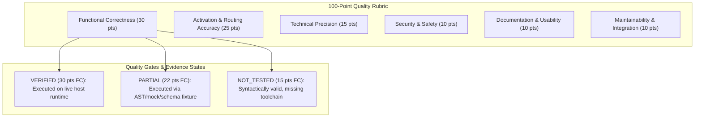

# DEX Engineering Skills Framework v10.0 — Architectural Specification

> **Principal Architecture Blueprint for 500 Specialized Skills + Master Orchestrator + Polyglot Script Engine + Quality Verification Architecture**

---

## 1. System Topology & Directory Structure

DEX v10.0 is organized into four strictly separated tiers: Native Skills Catalog, Segregated Upstream Integrations, Polyglot Script Engine, and Quality & SkillOps Toolchain.

```
dex-engineering-skills/
├── .agents/skills/                    # Native DEX Catalog (Exactly 501 skills)
│   ├── dex-master-orchestrator/       # Master Control Plane (Skill 000)
│   ├── dex-development-workflow/      # Skill 001 (Group A)
│   │   └── SKILL.md                   # 14 Mandatory Sections (Spec compliant)
│   └── ...                            # Skills 002 to 500 (Groups A to AX)
├── integrations/                      # Segregated Third-Party Upstream Integrations
│   ├── aas/                           # Agentic Awesome Skills (MIT)
│   ├── mattpocock/                    # Matt Pocock Skills (MIT)
│   ├── rea/                           # Reverse Engineer Anything (Apache-2.0, MCP Adapter)
│   ├── reverse-skill/                 # Reverse Skill (MIT)
│   ├── supabase/                      # Supabase Agent Skills (MIT)
│   ├── superpowers/                   # Superpowers Skills (MIT)
│   └── ui-ux-pro-max/                 # UI/UX Pro Max (MIT, Search Bridge)
├── manifests/                         # Machine-Readable Catalog Registry
│   ├── dex-skills.json                # Complete metadata index of 501 native skills + 8 adapters
│   ├── native-skills.json             # Pinned catalog targets & canonical index mapping
│   └── upstream-sources.json          # Pinned commits and licensing for 7 upstream repos
├── scripts/                           # Quality Toolchain & Polyglot Engine
│   ├── polyglot/                      # DEX Polyglot Script Engine v10.0 (11 Runtimes)
│   │   ├── core/                      # Executor, detector, security, schema, reporting
│   │   ├── adapters/                  # 11 language runtime adapters
│   │   ├── wrappers/                  # dex.ps1, dex.bat, dex.sh
│   │   ├── schemas/                   # result.schema.json
│   │   └── dex.py                     # Unified CLI entrypoint (with verify subcommand)
│   ├── audit_skills.py                # 100-Point quality rubric & security auditor
│   ├── validate_skills.py             # Zero-dependency specification validator
│   ├── evaluate_routing_v10.py        # 25-scenario V10 dynamic routing benchmark (Groups A-AX)
│   ├── fix_dangling_references.py     # Automated cross-reference remediation
│   └── skillops.py                    # Read-only catalog evidence & release gates
├── tests/                             # Comprehensive Pytest Test Suite (>1,689 tests)
│   ├── test_skill_structure.py        # Directory, file presence, and 14-section validation
│   ├── test_skill_metadata.py         # YAML frontmatter conformity
│   ├── test_skill_registry.py         # Asserts exact 500+1 counts and 50-group taxonomy
│   ├── test_skill_security.py         # Screens against unsafe tokens and injection
│   ├── test_skill_dependencies.py     # DAG cycle detection and reference integrity
│   ├── test_skill_routing.py          # Routing matrix validation
│   ├── test_functional_v10.py         # Multi-domain real-world functional test harness
│   └── test_quality_scoring_v10.py    # 100-point quality scoring test suite
└── docs/                              # Framework Specifications & Quality Governance
    ├── quality/                       # V10 Quality Governance
    │   ├── BASELINE_V10.md            # Empirical release baseline
    │   ├── SKILL_AUDIT_V10.json       # Per-skill 100-point quality audit records
    │   ├── DEFECT_REGISTER.md         # Exhaustive defect register & remediation log
    │   └── DEX_V10_ROUTING_FIXTURES.json # 25/25 routing execution evidence
    └── audits/                        # Historical audit archives (v6, v8, v9)
```

---

## 2. Canonical Engineering Taxonomy (50 Groups)

The framework organizes 500 specialized skills into 50 canonical engineering groups, each containing exactly 10 specialists, presided over by `dex-master-orchestrator`:

| Group | Skills Range | Domain | Focus Area |
|:---|:---:|:---|:---|
| **Root** | 000 | Master Orchestration | `dex-master-orchestrator` Root Control Plane |
| **A** | 001–010 | Core Engineering | Development workflow, task breakdown, atomic git commits |
| **B** | 011–020 | Architecture & AI Agents | Modular architecture, multi-agent coordination, database design |
| **C** | 021–030 | Production Engineering | Impact analysis, reliability, feature flags, code review |
| **D** | 031–040 | Frontend Engineering | Component contracts, data flow, accessibility, SSR |
| **E** | 041–050 | Backend & Integration | Event-driven architecture, idempotency, background job queues |
| **F** | 051–060 | Data Engineering | Data contracts, pipelines, query plan optimization |
| **G** | 061–070 | AI & LLM Engineering | RAG pipelines, retrieval evaluation, LLM cost controls |
| **H** | 071–080 | Developer Experience | Monorepo governance, CLI engineering, semantic versioning |
| **I** | 081–090 | Security & Reliability | Secrets management, circuit breakers, incident postmortems |
| **J** | 091–100 | Cloud & Infrastructure | Cloud network design, infrastructure contracts, container topology |
| **K** | 101–110 | Mobile & Desktop Engineering | Safe area layouts, offline sync, performance profiling |
| **L** | 111–120 | Product & Operations Engineering | Growth experiments, A/B testing statistics, telemetry |
| **M** | 121–130 | Advanced Software Verification | Contract-first development, fuzzing, property-based tests |
| **N** | 131–140 | Advanced SRE & Distributed Systems | Distributed tracing, chaos engineering, consensus protocols |
| **O** | 141–150 | Advanced Cloud Platform | Multi-region data residency, failover drills, cost tuning |
| **P** | 151–160 | Language & Runtime Engineering | FFI boundaries, memory safety, binary inspection |
| **Q** | 161–170 | Advanced AI Systems | Training data leakage audit, prompt injection defenses |
| **R** | 171–180 | Product Design & User Research | Design systems documentation, usability research |
| **S** | 181–190 | Application Security Specialists | API security boundaries, zero-trust verification |
| **T** | 191–200 | SkillOps Engineering | Skill evaluation benchmarks, quality gates |
| **U** | 201–210 | Visual Design Intelligence | Visual hierarchy audit, fluid typography, WCAG compliance |
| **V** | 211–220 | Advanced Web Experiences | Web animation performance, micro-frontend boundaries |
| **W** | 221–230 | Browser Extensions & Automation | Extension MV3, artifact signature verification, SLSA |
| **X** | 231–240 | Authorized Reverse Engineering | Bundle deobfuscation, bytecode analysis, binary diffing |
| **Y** | 241–250 | Protocols & Service Integration | Service contract simulation, gRPC/Protobuf evolution |
| **Z** | 251–260 | AI Agent Operations | Agent evaluation harness, state persistence, memory governance |
| **AA** | 261–270 | Advanced Data & Analytics | Columnar storage optimization, stream processing |
| **AB** | 271–280 | Native, Graphics & Game Engineering | Native performance profiling, shaders, game state machines |
| **AC** | 281–290 | Software Trust & Distribution | Supply chain trust, signed release attestation |
| **AD** | 291–300 | Advanced SkillOps Governance | Catalog health, dependency cycle analysis |
| **AE** | 301–310 | Enterprise Software Architecture | Clean architecture boundaries, domain event streaming |
| **AF** | 311–320 | Distributed Systems Deep Engineering | Raft consensus, vector clocks, split-brain mitigation |
| **AG** | 321–330 | Applied AI Systems | Fine-tuning dataset curation, LLM guardrails |
| **AH** | 331–340 | Extended Polyglot Engineering | Cross-language FFI interop, multi-runtime bridges |
| **AI** | 341–350 | Advanced UI/UX Engineering | Design token migration, high-density dashboard layouts |
| **AJ** | 351–360 | Authorized Software Inspection | Static binary analysis, memory leak diagnostics |
| **AK** | 361–370 | ML Platform & Data Systems | Feature store engineering, model inference privacy |
| **AL** | 371–380 | Developer Platform & Polyglot Tooling | CLI command contracts, AST transformation tooling |
| **AM** | 381–390 | Advanced Security & Trust | Secret rotation drills, audit trail immutability |
| **AN** | 391–400 | SkillOps Quality & Governance | Automated skill compliance, release readiness gates |
| **AO** | 401–410 | Supabase & Advanced PostgreSQL | PostgreSQL RLS policy verification, storage policies |
| **AP** | 411–420 | Autonomous Agent Engineering | Tool permission modeling, execution budget cutoffs |
| **AQ** | 421–430 | Streaming & Digital Media Systems | HLS/DASH manifest validation, video transcoding ladders |
| **AR** | 431–440 | Chess & Native Performance | UCI protocol compliance, Perft movegen, Zobrist hashing |
| **AS** | 441–450 | Windows & Desktop Systems | Win32 DPI multi-monitor scaling, COM interop boundaries |
| **AT** | 451–460 | Platform Resilience & Infrastructure | Kubernetes secret delivery, Terraform contract tests |
| **AU** | 461–470 | Product Experience & Design Systems | Design critique rubrics, responsive layout verification |
| **AV** | 471–480 | Advanced TypeScript & Full Stack | Package dual-publish (ESM/CJS), Next.js data cache |
| **AW** | 481–490 | Security, Privacy & Resilience Governance | Dependency provenance attestation, SLSA build controls |
| **AX** | 491–500 | SkillOps Intelligence & Scalability | Skill conflict precedence, lifecycle health dashboards |

---

## 3. V10 Quality Gate Architecture (100-Point Rubric)

DEX v10.0 enforces an evidence-based Quality Architecture where each skill is audited across 6 weighted dimensions:



1. **Functional Correctness (30 pts):** Verified real-world execution. No skill receives 30 points without reproducible execution evidence.
2. **Activation & Routing Accuracy (25 pts):** Trigger conditions, distinct `When to Use` vs `When NOT to Use`, concise descriptions, verified routing benchmark results.
3. **Technical Precision (15 pts):** Full 14-section compliance, explicit inputs/outputs, measurable acceptance criteria.
4. **Security & Safety (10 pts):** Zero prompt injection vulnerabilities, zero destructive command patterns (`rm -rf /`, `curl | sh`), credential isolation.
5. **Documentation & Usability (10 pts):** Actionable step-by-step workflow, realistic implementation scenarios, readable markdown.
6. **Maintainability & Integration (10 pts):** Zero dangling references in Section 13, valid cross-skill integration links, platform adapter definitions.

---

## 4. Polyglot Script Engine Architecture

The Polyglot Script Engine (`scripts/polyglot/`) provides automated, multi-language execution through 11 language adapters:

- **Python Adapter:** `python`, `pytest`, AST inspection, linting.
- **TypeScript / JavaScript Adapter:** `node`, `npm`, `npx`, schema verification, ESM/CJS compatibility.
- **PowerShell Adapter:** Windows management, security execution policies, system probes.
- **C++ Adapter:** `cmake` validation, native compilation (when compiler available).
- **Graceful Toolchain Degradation:** Missing runtimes (Rust, Go, C#, Java, PHP, Bash) return `TOOL_NOT_AVAILABLE` with exit code 127/0 and installation instructions, never manufacturing false success.
