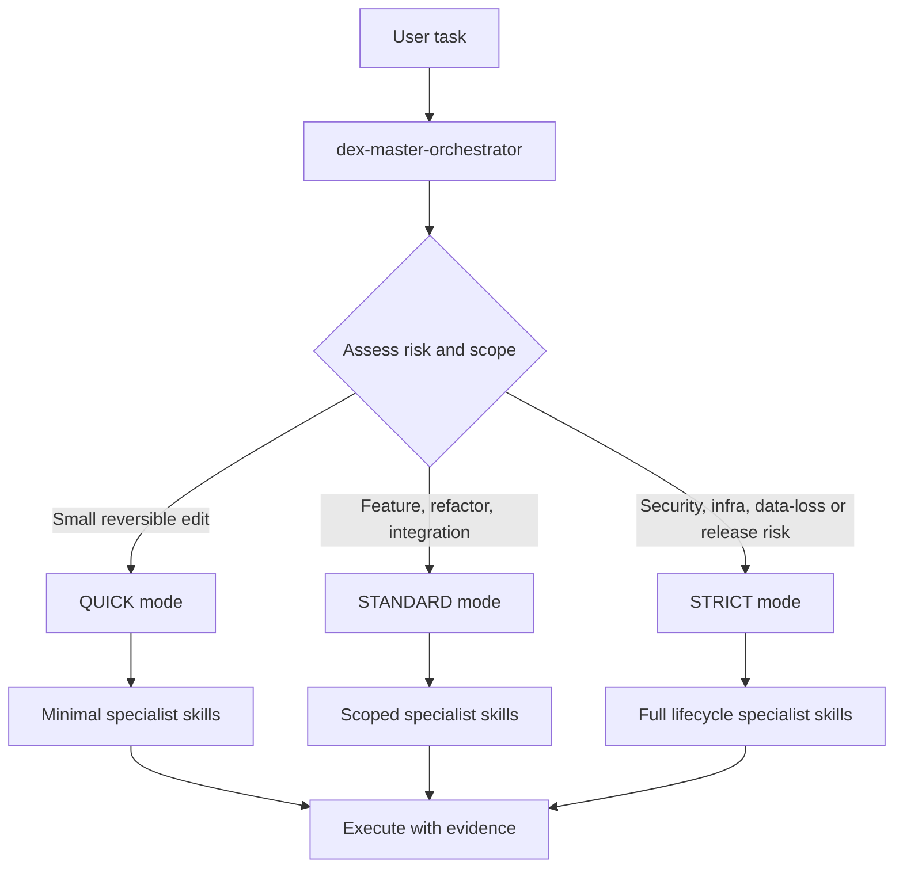

<div align="center">

# DEX Engineering Skills Framework v10.0

**501 native agent skills and 8 upstream adapters — routed, validated, and audited.**

[](https://github.com/nguyenducanhst2022-png/dex-engineering-skills/actions/workflows/validate.yml)
[](LICENSE)
[](INSTALL.md)
[](SKILLS_INDEX.md)

</div>

A catalog of **501 native agent skills**: 500 specialists in 50 groups (A–AX, ten skills each, IDs 001–500) plus one root router, `dex-master-orchestrator`. Eight external adapters live under `integrations/` and are not part of the native count.

Skills use the YAML frontmatter + Markdown format of the [Agent Skills specification](https://agentskills.io/specification). The 14-section body structure is a repository convention, not a spec requirement.

## Table of Contents

- [Overview](#overview)
- [Why DEX](#why-dex)
- [Repository Layout](#repository-layout)
- [Skill Taxonomy — 50 Groups](#skill-taxonomy--50-groups)
  - [Full Skill Catalog](#full-skill-catalog)
- [Quick Start](#quick-start)
- [Connecting Your Agent](#connecting-your-agent)
- [How Routing Works](#how-routing-works)
- [Polyglot CLI](#polyglot-cli)
- [Quality and Verification](#quality-and-verification)
- [Skill Anatomy](#skill-anatomy)
- [Upstream Integrations](#upstream-integrations)
- [Project Status](#project-status)
- [Contributing](#contributing)
- [Documentation](#documentation)
- [License](#license)

## Overview

DEX Engineering Skills v10.0 is a file-based catalog of engineering knowledge for coding agents. Each native skill is a directory under `.agents/skills/<name>/` containing a `SKILL.md` file with YAML frontmatter and 14 numbered sections.

The root skill `dex-master-orchestrator` is the entry point. It selects the smallest sufficient set of specialist skills for a task and assigns one of three execution modes: QUICK, STANDARD, or STRICT.

Verification is structural and evidence-based:

- `validate`: 501/501 native + 8/8 integrations
- Routing fixtures: 25/25
- Quality audit average: 85.4/100
- pytest suite: 1,706 tests pass

> [!NOTE]
> `AGENTS.example.md` in this repository is a legacy example template that references an older v3.0 layout. Do not use it for current counts or structure. Current facts are in this README, `SKILLS_INDEX.md`, and `manifests/native-skills.json`.

## Why DEX

- Single entry point for 501 skills via `dex-master-orchestrator`.
- Full 50-group taxonomy from core engineering to SkillOps intelligence, mapped in `manifests/native-skills.json`.
- Strict separation between native skills and third-party adapters under `integrations/`.
- Machine-readable registries in `manifests/`: `native-skills.json`, `dex-skills.json`, `upstream-sources.json`.
- Reproducible checks: pytest, `validate_skills.py`, `check_skill_depth.py`, `audit_skills.py --export-v10`, `evaluate_routing_v10.py`, and polyglot `verify` / `skills validate`.
- Cross-platform CI defined in `.github/workflows/validate.yml`, named `DEX verification`.
- Polyglot CLI `scripts/polyglot/dex.py` for Python, TypeScript, JavaScript, PowerShell, Bash, Rust, Go, C++, C#, Java and PHP workflows, plus read-only catalog commands.

> [!IMPORTANT]
> Cloning the repository installs no runtimes and changes no global settings. Skill discovery and tool permissions depend on the host agent.

## Repository Layout

| Path | Contents |
|:---|:---|
| `.agents/skills/<name>/SKILL.md` | The 501 native skills |
| `integrations/` | 7 upstream sources (8 adapters), kept separate from native skills |
| `manifests/` | `native-skills.json` (canonical IDs), `dex-skills.json` (discovered files), `upstream-sources.json` (pins, license hashes) |
| `scripts/` | Validation, audit, routing evaluation; `scripts/polyglot/dex.py` CLI |
| `tests/` | pytest suite |
| `docs/quality/`, `docs/audits/` | Audit records and evidence |
| `.github/workflows/validate.yml` | CI on Ubuntu, Windows and macOS (Ubuntu Python 3.10–3.13; Windows and macOS Python 3.12) |

Find individual skills in the [skills index](SKILLS_INDEX.md). Group and domain mapping is in the index and [`manifests/native-skills.json`](manifests/native-skills.json).

## Skill Taxonomy — 50 Groups

500 specialists in groups A–AX, plus the root router `dex-master-orchestrator` (ID 000).

<details>
<summary>Expand full 50-group table</summary>

| Group | Skills Range | Domain | Focus Area |
|:---|:---:|:---|:---|
| **Root** | 000 | Master Orchestration | `dex-master-orchestrator` Root Control Plane |
| **A** | 001–010 | Core Engineering | Development workflow, task breakdown, atomic git commits |
| **B** | 011–020 | Architecture & AI Agents | Modular architecture, multi-agent coordination, database design |
| **C** | 021–030 | Production Engineering | Impact analysis, reliability, feature flags, code review |
| **D** | 031–040 | Frontend Engineering | Component contracts, data flow, accessibility, SSR |
| **E** | 041–050 | Backend & Integration | Event-driven architecture, idempotency, background job queues |
| **F** | 051–060 | Data Engineering | Data contracts, pipelines, query plan optimization |
| **G** | 061–070 | AI & LLM Engineering | RAG pipelines, retrieval evaluation, LLM cost controls |
| **H** | 071–080 | Developer Experience | Monorepo governance, CLI engineering, semantic versioning |
| **I** | 081–090 | Security & Reliability | Secrets management, circuit breakers, incident postmortems |
| **J** | 091–100 | Cloud & Infrastructure | Cloud network design, infrastructure contracts, container topology |
| **K** | 101–110 | Mobile & Desktop Engineering | Safe area layouts, offline sync, performance profiling |
| **L** | 111–120 | Product & Operations Engineering | Growth experiments, A/B testing statistics, telemetry |
| **M** | 121–130 | Advanced Software Verification | Contract-first development, fuzzing, property-based tests |
| **N** | 131–140 | Advanced SRE & Distributed Systems | Distributed tracing, chaos engineering, consensus protocols |
| **O** | 141–150 | Advanced Cloud Platform | Multi-region data residency, failover drills, cost tuning |
| **P** | 151–160 | Language & Runtime Engineering | FFI boundaries, memory safety, binary inspection |
| **Q** | 161–170 | Advanced AI Systems | Training data leakage audit, prompt injection defenses |
| **R** | 171–180 | Product Design & User Research | Design systems documentation, usability research |
| **S** | 181–190 | Application Security Specialists | API security boundaries, zero-trust verification |
| **T** | 191–200 | SkillOps Engineering | Skill evaluation benchmarks, quality gates |
| **U** | 201–210 | Visual Design Intelligence | Visual hierarchy audit, fluid typography, WCAG compliance |
| **V** | 211–220 | Advanced Web Experiences | Web animation performance, micro-frontend boundaries |
| **W** | 221–230 | Browser Extensions & Automation | Extension MV3, artifact signature verification, SLSA |
| **X** | 231–240 | Authorized Reverse Engineering | Bundle deobfuscation, bytecode analysis, binary diffing |
| **Y** | 241–250 | Protocols & Service Integration | Service contract simulation, gRPC/Protobuf evolution |
| **Z** | 251–260 | AI Agent Operations | Agent evaluation harness, state persistence, memory governance |
| **AA** | 261–270 | Advanced Data & Analytics | Columnar storage optimization, stream processing |
| **AB** | 271–280 | Native, Graphics & Game Engineering | Native performance profiling, shaders, game state machines |
| **AC** | 281–290 | Software Trust & Distribution | Supply chain trust, signed release attestation |
| **AD** | 291–300 | Advanced SkillOps Governance | Catalog health, dependency cycle analysis |
| **AE** | 301–310 | Enterprise Software Architecture | Clean architecture boundaries, domain event streaming |
| **AF** | 311–320 | Distributed Systems Deep Engineering | Raft consensus, vector clocks, split-brain mitigation |
| **AG** | 321–330 | Applied AI Systems | Fine-tuning dataset curation, LLM guardrails |
| **AH** | 331–340 | Extended Polyglot Engineering | Cross-language FFI interop, multi-runtime bridges |
| **AI** | 341–350 | Advanced UI/UX Engineering | Design token migration, high-density dashboard layouts |
| **AJ** | 351–360 | Authorized Software Inspection | Static binary analysis, memory leak diagnostics |
| **AK** | 361–370 | ML Platform & Data Systems | Feature store engineering, model inference privacy |
| **AL** | 371–380 | Developer Platform & Polyglot Tooling | CLI command contracts, AST transformation tooling |
| **AM** | 381–390 | Advanced Security & Trust | Secret rotation drills, audit trail immutability |
| **AN** | 391–400 | SkillOps Quality & Governance | Automated skill compliance, release readiness gates |
| **AO** | 401–410 | Supabase & Advanced PostgreSQL | PostgreSQL RLS policy verification, storage policies |
| **AP** | 411–420 | Autonomous Agent Engineering | Tool permission modeling, execution budget cutoffs |
| **AQ** | 421–430 | Streaming & Digital Media Systems | HLS/DASH manifest validation, video transcoding ladders |
| **AR** | 431–440 | Chess & Native Performance | UCI protocol compliance, Perft movegen, Zobrist hashing |
| **AS** | 441–450 | Windows & Desktop Systems | Win32 DPI multi-monitor scaling, COM interop boundaries |
| **AT** | 451–460 | Platform Resilience & Infrastructure | Kubernetes secret delivery, Terraform contract tests |
| **AU** | 461–470 | Product Experience & Design Systems | Design critique rubrics, responsive layout verification |
| **AV** | 471–480 | Advanced TypeScript & Full Stack | Package dual-publish (ESM/CJS), Next.js data cache |
| **AW** | 481–490 | Security, Privacy & Resilience Governance | Dependency provenance attestation, SLSA build controls |
| **AX** | 491–500 | SkillOps Intelligence & Scalability | Skill conflict precedence, lifecycle health dashboards |

</details>

### Full Skill Catalog

Every skill, grouped. Click a group to expand it.

<details>
<summary><b>Root</b> — Master Orchestrator (1)</summary>

[`dex-master-orchestrator`](.agents/skills/dex-master-orchestrator/SKILL.md)

</details>

<details>
<summary><b>Group A</b> — Core Engineering (10)</summary>

[`dex-development-workflow`](.agents/skills/dex-development-workflow/SKILL.md), [`dex-task-delegation`](.agents/skills/dex-task-delegation/SKILL.md), [`dex-code-verification`](.agents/skills/dex-code-verification/SKILL.md), [`dex-git-workflow`](.agents/skills/dex-git-workflow/SKILL.md), [`dex-code-organization`](.agents/skills/dex-code-organization/SKILL.md), [`dex-root-cause-debugging`](.agents/skills/dex-root-cause-debugging/SKILL.md), [`dex-performance-optimization`](.agents/skills/dex-performance-optimization/SKILL.md), [`dex-security-audit`](.agents/skills/dex-security-audit/SKILL.md), [`dex-cicd-automation`](.agents/skills/dex-cicd-automation/SKILL.md), [`dex-release-engineering`](.agents/skills/dex-release-engineering/SKILL.md)

</details>

<details>
<summary><b>Group B</b> — Architecture & AI Agents (10)</summary>

[`dex-production-monitoring`](.agents/skills/dex-production-monitoring/SKILL.md), [`dex-technical-debt-refactoring`](.agents/skills/dex-technical-debt-refactoring/SKILL.md), [`dex-software-architecture`](.agents/skills/dex-software-architecture/SKILL.md), [`dex-database-engineering`](.agents/skills/dex-database-engineering/SKILL.md), [`dex-api-engineering`](.agents/skills/dex-api-engineering/SKILL.md), [`dex-testing-engineering`](.agents/skills/dex-testing-engineering/SKILL.md), [`dex-agent-engineering`](.agents/skills/dex-agent-engineering/SKILL.md), [`dex-multi-agent-orchestration`](.agents/skills/dex-multi-agent-orchestration/SKILL.md), [`dex-context-engineering`](.agents/skills/dex-context-engineering/SKILL.md), [`dex-specification-driven`](.agents/skills/dex-specification-driven/SKILL.md)

</details>

<details>
<summary><b>Group C</b> — Production Engineering (10)</summary>

[`dex-change-impact-analysis`](.agents/skills/dex-change-impact-analysis/SKILL.md), [`dex-dependency-management`](.agents/skills/dex-dependency-management/SKILL.md), [`dex-reliability-engineering`](.agents/skills/dex-reliability-engineering/SKILL.md), [`dex-concurrency-state`](.agents/skills/dex-concurrency-state/SKILL.md), [`dex-ux-accessibility`](.agents/skills/dex-ux-accessibility/SKILL.md), [`dex-feature-flags`](.agents/skills/dex-feature-flags/SKILL.md), [`dex-code-review`](.agents/skills/dex-code-review/SKILL.md), [`dex-acceptance-testing`](.agents/skills/dex-acceptance-testing/SKILL.md), [`dex-software-maintenance`](.agents/skills/dex-software-maintenance/SKILL.md), [`dex-end-to-end-engineering`](.agents/skills/dex-end-to-end-engineering/SKILL.md)

</details>

<details>
<summary><b>Group D</b> — Frontend Engineering (10)</summary>

[`dex-ui-component-contracts`](.agents/skills/dex-ui-component-contracts/SKILL.md), [`dex-design-system-tokens`](.agents/skills/dex-design-system-tokens/SKILL.md), [`dex-frontend-data-flow`](.agents/skills/dex-frontend-data-flow/SKILL.md), [`dex-forms-and-validation`](.agents/skills/dex-forms-and-validation/SKILL.md), [`dex-routing-navigation`](.agents/skills/dex-routing-navigation/SKILL.md), [`dex-frontend-performance`](.agents/skills/dex-frontend-performance/SKILL.md), [`dex-ssr-seo-rendering`](.agents/skills/dex-ssr-seo-rendering/SKILL.md), [`dex-internationalization`](.agents/skills/dex-internationalization/SKILL.md), [`dex-visual-regression`](.agents/skills/dex-visual-regression/SKILL.md), [`dex-browser-compatibility`](.agents/skills/dex-browser-compatibility/SKILL.md)

</details>

<details>
<summary><b>Group E</b> — Backend & Integration (10)</summary>

[`dex-domain-driven-design`](.agents/skills/dex-domain-driven-design/SKILL.md), [`dex-background-job-queues`](.agents/skills/dex-background-job-queues/SKILL.md), [`dex-caching-strategies`](.agents/skills/dex-caching-strategies/SKILL.md), [`dex-realtime-protocols`](.agents/skills/dex-realtime-protocols/SKILL.md), [`dex-file-processing`](.agents/skills/dex-file-processing/SKILL.md), [`dex-search-engineering`](.agents/skills/dex-search-engineering/SKILL.md), [`dex-event-driven-architecture`](.agents/skills/dex-event-driven-architecture/SKILL.md), [`dex-idempotent-operations`](.agents/skills/dex-idempotent-operations/SKILL.md), [`dex-notification-delivery`](.agents/skills/dex-notification-delivery/SKILL.md), [`dex-scheduled-workflows`](.agents/skills/dex-scheduled-workflows/SKILL.md)

</details>

<details>
<summary><b>Group F</b> — Data Engineering (10)</summary>

[`dex-data-contracts`](.agents/skills/dex-data-contracts/SKILL.md), [`dex-data-pipelines`](.agents/skills/dex-data-pipelines/SKILL.md), [`dex-data-quality-audits`](.agents/skills/dex-data-quality-audits/SKILL.md), [`dex-data-lineage`](.agents/skills/dex-data-lineage/SKILL.md), [`dex-schema-evolution`](.agents/skills/dex-schema-evolution/SKILL.md), [`dex-database-query-plans`](.agents/skills/dex-database-query-plans/SKILL.md), [`dex-storage-lifecycle`](.agents/skills/dex-storage-lifecycle/SKILL.md), [`dex-data-retention`](.agents/skills/dex-data-retention/SKILL.md), [`dex-capacity-planning`](.agents/skills/dex-capacity-planning/SKILL.md), [`dex-disaster-recovery`](.agents/skills/dex-disaster-recovery/SKILL.md)

</details>

<details>
<summary><b>Group G</b> — AI & LLM Engineering (10)</summary>

[`dex-llm-integration`](.agents/skills/dex-llm-integration/SKILL.md), [`dex-rag-pipelines`](.agents/skills/dex-rag-pipelines/SKILL.md), [`dex-retrieval-evaluation`](.agents/skills/dex-retrieval-evaluation/SKILL.md), [`dex-prompt-evaluation`](.agents/skills/dex-prompt-evaluation/SKILL.md), [`dex-model-evaluation`](.agents/skills/dex-model-evaluation/SKILL.md), [`dex-tool-calling-contracts`](.agents/skills/dex-tool-calling-contracts/SKILL.md), [`dex-agent-permissions`](.agents/skills/dex-agent-permissions/SKILL.md), [`dex-llm-cost-controls`](.agents/skills/dex-llm-cost-controls/SKILL.md), [`dex-ai-observability`](.agents/skills/dex-ai-observability/SKILL.md), [`dex-dataset-curation`](.agents/skills/dex-dataset-curation/SKILL.md)

</details>

<details>
<summary><b>Group H</b> — Developer Experience (10)</summary>

[`dex-repository-bootstrap`](.agents/skills/dex-repository-bootstrap/SKILL.md), [`dex-monorepo-governance`](.agents/skills/dex-monorepo-governance/SKILL.md), [`dex-cli-engineering`](.agents/skills/dex-cli-engineering/SKILL.md), [`dex-plugin-architecture`](.agents/skills/dex-plugin-architecture/SKILL.md), [`dex-cross-platform-portability`](.agents/skills/dex-cross-platform-portability/SKILL.md), [`dex-windows-packaging`](.agents/skills/dex-windows-packaging/SKILL.md), [`dex-documentation-as-code`](.agents/skills/dex-documentation-as-code/SKILL.md), [`dex-code-generation`](.agents/skills/dex-code-generation/SKILL.md), [`dex-developer-tooling`](.agents/skills/dex-developer-tooling/SKILL.md), [`dex-semantic-version-automation`](.agents/skills/dex-semantic-version-automation/SKILL.md)

</details>

<details>
<summary><b>Group I</b> — Security & Reliability (10)</summary>

[`dex-auth-session-lifecycle`](.agents/skills/dex-auth-session-lifecycle/SKILL.md), [`dex-access-control-tenancy`](.agents/skills/dex-access-control-tenancy/SKILL.md), [`dex-secrets-management`](.agents/skills/dex-secrets-management/SKILL.md), [`dex-supply-chain-security`](.agents/skills/dex-supply-chain-security/SKILL.md), [`dex-threat-modeling`](.agents/skills/dex-threat-modeling/SKILL.md), [`dex-property-based-testing`](.agents/skills/dex-property-based-testing/SKILL.md), [`dex-chaos-experiments`](.agents/skills/dex-chaos-experiments/SKILL.md), [`dex-experimentation-metrics`](.agents/skills/dex-experimentation-metrics/SKILL.md), [`dex-api-contract-evolution`](.agents/skills/dex-api-contract-evolution/SKILL.md), [`dex-incident-postmortems`](.agents/skills/dex-incident-postmortems/SKILL.md)

</details>

<details>
<summary><b>Group J</b> — Cloud & Infrastructure (10)</summary>

[`dex-container-image-engineering`](.agents/skills/dex-container-image-engineering/SKILL.md), [`dex-kubernetes-deployment`](.agents/skills/dex-kubernetes-deployment/SKILL.md), [`dex-infrastructure-as-code`](.agents/skills/dex-infrastructure-as-code/SKILL.md), [`dex-cloud-service-integration`](.agents/skills/dex-cloud-service-integration/SKILL.md), [`dex-zero-downtime-rollouts`](.agents/skills/dex-zero-downtime-rollouts/SKILL.md), [`dex-service-mesh-networking`](.agents/skills/dex-service-mesh-networking/SKILL.md), [`dex-network-troubleshooting`](.agents/skills/dex-network-troubleshooting/SKILL.md), [`dex-slo-error-budgets`](.agents/skills/dex-slo-error-budgets/SKILL.md), [`dex-distributed-tracing`](.agents/skills/dex-distributed-tracing/SKILL.md), [`dex-cloud-cost-finops`](.agents/skills/dex-cloud-cost-finops/SKILL.md)

</details>

<details>
<summary><b>Group K</b> — Mobile & Desktop Engineering (10)</summary>

[`dex-android-app-architecture`](.agents/skills/dex-android-app-architecture/SKILL.md), [`dex-ios-app-architecture`](.agents/skills/dex-ios-app-architecture/SKILL.md), [`dex-electron-security`](.agents/skills/dex-electron-security/SKILL.md), [`dex-tauri-desktop-integration`](.agents/skills/dex-tauri-desktop-integration/SKILL.md), [`dex-mobile-offline-sync`](.agents/skills/dex-mobile-offline-sync/SKILL.md), [`dex-mobile-release-pipelines`](.agents/skills/dex-mobile-release-pipelines/SKILL.md), [`dex-mobile-performance-profiling`](.agents/skills/dex-mobile-performance-profiling/SKILL.md), [`dex-desktop-ipc-design`](.agents/skills/dex-desktop-ipc-design/SKILL.md), [`dex-native-device-integration`](.agents/skills/dex-native-device-integration/SKILL.md), [`dex-desktop-update-delivery`](.agents/skills/dex-desktop-update-delivery/SKILL.md)

</details>

<details>
<summary><b>Group L</b> — Product & Operations Engineering (10)</summary>

[`dex-privacy-impact-assessment`](.agents/skills/dex-privacy-impact-assessment/SKILL.md), [`dex-compliance-control-mapping`](.agents/skills/dex-compliance-control-mapping/SKILL.md), [`dex-audit-trail-integrity`](.agents/skills/dex-audit-trail-integrity/SKILL.md), [`dex-configuration-drift`](.agents/skills/dex-configuration-drift/SKILL.md), [`dex-product-discovery`](.agents/skills/dex-product-discovery/SKILL.md), [`dex-feature-prioritization`](.agents/skills/dex-feature-prioritization/SKILL.md), [`dex-analytics-instrumentation`](.agents/skills/dex-analytics-instrumentation/SKILL.md), [`dex-feedback-triage`](.agents/skills/dex-feedback-triage/SKILL.md), [`dex-runbook-automation`](.agents/skills/dex-runbook-automation/SKILL.md), [`dex-operational-readiness-review`](.agents/skills/dex-operational-readiness-review/SKILL.md)

</details>

<details>
<summary><b>Group M</b> — Advanced Software Verification (10)</summary>

[`dex-static-analysis-rule-authoring`](.agents/skills/dex-static-analysis-rule-authoring/SKILL.md), [`dex-mutation-testing`](.agents/skills/dex-mutation-testing/SKILL.md), [`dex-api-fuzz-testing`](.agents/skills/dex-api-fuzz-testing/SKILL.md), [`dex-differential-testing`](.agents/skills/dex-differential-testing/SKILL.md), [`dex-flaky-test-remediation`](.agents/skills/dex-flaky-test-remediation/SKILL.md), [`dex-test-data-management`](.agents/skills/dex-test-data-management/SKILL.md), [`dex-compatibility-matrix-testing`](.agents/skills/dex-compatibility-matrix-testing/SKILL.md), [`dex-reproducible-benchmarking`](.agents/skills/dex-reproducible-benchmarking/SKILL.md), [`dex-formal-invariant-checks`](.agents/skills/dex-formal-invariant-checks/SKILL.md), [`dex-coverage-risk-analysis`](.agents/skills/dex-coverage-risk-analysis/SKILL.md)

</details>

<details>
<summary><b>Group N</b> — Advanced SRE & Distributed Systems (10)</summary>

[`dex-load-and-stress-testing`](.agents/skills/dex-load-and-stress-testing/SKILL.md), [`dex-traffic-shaping-backpressure`](.agents/skills/dex-traffic-shaping-backpressure/SKILL.md), [`dex-rate-limiting-quotas`](.agents/skills/dex-rate-limiting-quotas/SKILL.md), [`dex-distributed-consistency`](.agents/skills/dex-distributed-consistency/SKILL.md), [`dex-service-failover`](.agents/skills/dex-service-failover/SKILL.md), [`dex-alert-quality-engineering`](.agents/skills/dex-alert-quality-engineering/SKILL.md), [`dex-log-pipeline-design`](.agents/skills/dex-log-pipeline-design/SKILL.md), [`dex-metric-cardinality-control`](.agents/skills/dex-metric-cardinality-control/SKILL.md), [`dex-oncall-handover`](.agents/skills/dex-oncall-handover/SKILL.md), [`dex-operational-game-days`](.agents/skills/dex-operational-game-days/SKILL.md)

</details>

<details>
<summary><b>Group O</b> — Advanced Cloud Platform (10)</summary>

[`dex-serverless-architecture`](.agents/skills/dex-serverless-architecture/SKILL.md), [`dex-edge-runtime-engineering`](.agents/skills/dex-edge-runtime-engineering/SKILL.md), [`dex-cloud-iam-policy-review`](.agents/skills/dex-cloud-iam-policy-review/SKILL.md), [`dex-cloud-network-design`](.agents/skills/dex-cloud-network-design/SKILL.md), [`dex-gitops-workflows`](.agents/skills/dex-gitops-workflows/SKILL.md), [`dex-kubernetes-policy-enforcement`](.agents/skills/dex-kubernetes-policy-enforcement/SKILL.md), [`dex-platform-service-catalog`](.agents/skills/dex-platform-service-catalog/SKILL.md), [`dex-environment-promotion`](.agents/skills/dex-environment-promotion/SKILL.md), [`dex-service-discovery`](.agents/skills/dex-service-discovery/SKILL.md), [`dex-cloud-resource-tagging`](.agents/skills/dex-cloud-resource-tagging/SKILL.md)

</details>

<details>
<summary><b>Group P</b> — Language & Runtime Engineering (10)</summary>

[`dex-typescript-type-safety`](.agents/skills/dex-typescript-type-safety/SKILL.md), [`dex-nodejs-runtime-diagnostics`](.agents/skills/dex-nodejs-runtime-diagnostics/SKILL.md), [`dex-python-project-engineering`](.agents/skills/dex-python-project-engineering/SKILL.md), [`dex-rust-unsafe-audit`](.agents/skills/dex-rust-unsafe-audit/SKILL.md), [`dex-cpp-memory-safety`](.agents/skills/dex-cpp-memory-safety/SKILL.md), [`dex-go-concurrency-patterns`](.agents/skills/dex-go-concurrency-patterns/SKILL.md), [`dex-jvm-performance-diagnostics`](.agents/skills/dex-jvm-performance-diagnostics/SKILL.md), [`dex-dotnet-application-engineering`](.agents/skills/dex-dotnet-application-engineering/SKILL.md), [`dex-webassembly-integration`](.agents/skills/dex-webassembly-integration/SKILL.md), [`dex-ffi-boundary-contracts`](.agents/skills/dex-ffi-boundary-contracts/SKILL.md)

</details>

<details>
<summary><b>Group Q</b> — Advanced AI Systems (10)</summary>

[`dex-mcp-server-design`](.agents/skills/dex-mcp-server-design/SKILL.md), [`dex-vector-index-design`](.agents/skills/dex-vector-index-design/SKILL.md), [`dex-reranking-strategies`](.agents/skills/dex-reranking-strategies/SKILL.md), [`dex-structured-llm-output`](.agents/skills/dex-structured-llm-output/SKILL.md), [`dex-prompt-injection-defense`](.agents/skills/dex-prompt-injection-defense/SKILL.md), [`dex-grounding-citation-audit`](.agents/skills/dex-grounding-citation-audit/SKILL.md), [`dex-agent-memory-governance`](.agents/skills/dex-agent-memory-governance/SKILL.md), [`dex-multimodal-input-pipelines`](.agents/skills/dex-multimodal-input-pipelines/SKILL.md), [`dex-agent-evaluation-harness`](.agents/skills/dex-agent-evaluation-harness/SKILL.md), [`dex-llm-fallback-routing`](.agents/skills/dex-llm-fallback-routing/SKILL.md)

</details>

<details>
<summary><b>Group R</b> — Product Design & User Research (10)</summary>

[`dex-user-journey-mapping`](.agents/skills/dex-user-journey-mapping/SKILL.md), [`dex-information-architecture`](.agents/skills/dex-information-architecture/SKILL.md), [`dex-usability-study-design`](.agents/skills/dex-usability-study-design/SKILL.md), [`dex-accessibility-automation`](.agents/skills/dex-accessibility-automation/SKILL.md), [`dex-design-handoff-verification`](.agents/skills/dex-design-handoff-verification/SKILL.md), [`dex-product-requirements-writing`](.agents/skills/dex-product-requirements-writing/SKILL.md), [`dex-conversion-funnel-analysis`](.agents/skills/dex-conversion-funnel-analysis/SKILL.md), [`dex-feature-adoption-analysis`](.agents/skills/dex-feature-adoption-analysis/SKILL.md), [`dex-user-consent-ux`](.agents/skills/dex-user-consent-ux/SKILL.md), [`dex-supportability-engineering`](.agents/skills/dex-supportability-engineering/SKILL.md)

</details>

<details>
<summary><b>Group S</b> — Application Security Specialists (10)</summary>

[`dex-sast-finding-triage`](.agents/skills/dex-sast-finding-triage/SKILL.md), [`dex-dast-scoping`](.agents/skills/dex-dast-scoping/SKILL.md), [`dex-api-abuse-prevention`](.agents/skills/dex-api-abuse-prevention/SKILL.md), [`dex-web-security-headers`](.agents/skills/dex-web-security-headers/SKILL.md), [`dex-browser-extension-hardening`](.agents/skills/dex-browser-extension-hardening/SKILL.md), [`dex-sbom-verification`](.agents/skills/dex-sbom-verification/SKILL.md), [`dex-vulnerability-remediation`](.agents/skills/dex-vulnerability-remediation/SKILL.md), [`dex-security-logging-detection`](.agents/skills/dex-security-logging-detection/SKILL.md), [`dex-cryptographic-api-review`](.agents/skills/dex-cryptographic-api-review/SKILL.md), [`dex-secure-build-runners`](.agents/skills/dex-secure-build-runners/SKILL.md)

</details>

<details>
<summary><b>Group T</b> — SkillOps Engineering (10)</summary>

[`dex-skill-discovery-indexer`](.agents/skills/dex-skill-discovery-indexer/SKILL.md), [`dex-skill-license-provenance`](.agents/skills/dex-skill-license-provenance/SKILL.md), [`dex-skill-semantic-deduplication`](.agents/skills/dex-skill-semantic-deduplication/SKILL.md), [`dex-skill-security-screening`](.agents/skills/dex-skill-security-screening/SKILL.md), [`dex-skill-import-packaging`](.agents/skills/dex-skill-import-packaging/SKILL.md), [`dex-skill-upstream-sync`](.agents/skills/dex-skill-upstream-sync/SKILL.md), [`dex-skill-activation-evaluation`](.agents/skills/dex-skill-activation-evaluation/SKILL.md), [`dex-skill-host-adapters`](.agents/skills/dex-skill-host-adapters/SKILL.md), [`dex-skill-dependency-graph`](.agents/skills/dex-skill-dependency-graph/SKILL.md), [`dex-skill-quality-benchmarking`](.agents/skills/dex-skill-quality-benchmarking/SKILL.md)

</details>

<details>
<summary><b>Group U</b> — Visual Design Intelligence (10)</summary>

[`dex-design-brief-synthesis`](.agents/skills/dex-design-brief-synthesis/SKILL.md), [`dex-visual-hierarchy-audit`](.agents/skills/dex-visual-hierarchy-audit/SKILL.md), [`dex-layout-composition-patterns`](.agents/skills/dex-layout-composition-patterns/SKILL.md), [`dex-color-contrast-systems`](.agents/skills/dex-color-contrast-systems/SKILL.md), [`dex-fluid-typography-engineering`](.agents/skills/dex-fluid-typography-engineering/SKILL.md), [`dex-motion-interaction-specification`](.agents/skills/dex-motion-interaction-specification/SKILL.md), [`dex-dashboard-data-storytelling`](.agents/skills/dex-dashboard-data-storytelling/SKILL.md), [`dex-design-reference-evaluation`](.agents/skills/dex-design-reference-evaluation/SKILL.md), [`dex-design-system-documentation`](.agents/skills/dex-design-system-documentation/SKILL.md), [`dex-ui-visual-qa-review`](.agents/skills/dex-ui-visual-qa-review/SKILL.md)

</details>

<details>
<summary><b>Group V</b> — Advanced Web Experiences (10)</summary>

[`dex-web-animation-performance`](.agents/skills/dex-web-animation-performance/SKILL.md), [`dex-media-delivery-pipelines`](.agents/skills/dex-media-delivery-pipelines/SKILL.md), [`dex-hls-dash-playback`](.agents/skills/dex-hls-dash-playback/SKILL.md), [`dex-progressive-web-apps`](.agents/skills/dex-progressive-web-apps/SKILL.md), [`dex-web-push-permission-flow`](.agents/skills/dex-web-push-permission-flow/SKILL.md), [`dex-search-interface-experience`](.agents/skills/dex-search-interface-experience/SKILL.md), [`dex-virtualized-infinite-lists`](.agents/skills/dex-virtualized-infinite-lists/SKILL.md), [`dex-web-canvas-rendering`](.agents/skills/dex-web-canvas-rendering/SKILL.md), [`dex-webgpu-rendering-fundamentals`](.agents/skills/dex-webgpu-rendering-fundamentals/SKILL.md), [`dex-frontend-error-recovery`](.agents/skills/dex-frontend-error-recovery/SKILL.md)

</details>

<details>
<summary><b>Group W</b> — Browser Extensions & Automation (10)</summary>

[`dex-browser-extension-mv3`](.agents/skills/dex-browser-extension-mv3/SKILL.md), [`dex-extension-message-security`](.agents/skills/dex-extension-message-security/SKILL.md), [`dex-extension-background-lifecycle`](.agents/skills/dex-extension-background-lifecycle/SKILL.md), [`dex-extension-content-script-isolation`](.agents/skills/dex-extension-content-script-isolation/SKILL.md), [`dex-extension-storage-migration`](.agents/skills/dex-extension-storage-migration/SKILL.md), [`dex-browser-automation-testing`](.agents/skills/dex-browser-automation-testing/SKILL.md), [`dex-cdp-observability`](.agents/skills/dex-cdp-observability/SKILL.md), [`dex-headless-ui-verification`](.agents/skills/dex-headless-ui-verification/SKILL.md), [`dex-web-permission-ux`](.agents/skills/dex-web-permission-ux/SKILL.md), [`dex-cross-origin-integration`](.agents/skills/dex-cross-origin-integration/SKILL.md)

</details>

<details>
<summary><b>Group X</b> — Authorized Reverse Engineering (10)</summary>

[`dex-pe-elf-structure-inspection`](.agents/skills/dex-pe-elf-structure-inspection/SKILL.md), [`dex-native-symbol-mapping`](.agents/skills/dex-native-symbol-mapping/SKILL.md), [`dex-disassembly-cfg-reconstruction`](.agents/skills/dex-disassembly-cfg-reconstruction/SKILL.md), [`dex-managed-assembly-inspection`](.agents/skills/dex-managed-assembly-inspection/SKILL.md), [`dex-electron-artifact-analysis`](.agents/skills/dex-electron-artifact-analysis/SKILL.md), [`dex-javascript-sourcemap-recovery`](.agents/skills/dex-javascript-sourcemap-recovery/SKILL.md), [`dex-mobile-package-static-audit`](.agents/skills/dex-mobile-package-static-audit/SKILL.md), [`dex-firmware-metadata-inspection`](.agents/skills/dex-firmware-metadata-inspection/SKILL.md), [`dex-binary-diff-regression`](.agents/skills/dex-binary-diff-regression/SKILL.md), [`dex-reverse-evidence-chain`](.agents/skills/dex-reverse-evidence-chain/SKILL.md)

</details>

<details>
<summary><b>Group Y</b> — Protocols & Service Integration (10)</summary>

[`dex-mqtt-client-reliability`](.agents/skills/dex-mqtt-client-reliability/SKILL.md), [`dex-websocket-session-recovery`](.agents/skills/dex-websocket-session-recovery/SKILL.md), [`dex-stream-processing-semantics`](.agents/skills/dex-stream-processing-semantics/SKILL.md), [`dex-event-schema-registry`](.agents/skills/dex-event-schema-registry/SKILL.md), [`dex-http-client-connection-pooling`](.agents/skills/dex-http-client-connection-pooling/SKILL.md), [`dex-oauth-oidc-integration`](.agents/skills/dex-oauth-oidc-integration/SKILL.md), [`dex-webhook-signature-validation`](.agents/skills/dex-webhook-signature-validation/SKILL.md), [`dex-api-pagination-cursors`](.agents/skills/dex-api-pagination-cursors/SKILL.md), [`dex-service-contract-simulation`](.agents/skills/dex-service-contract-simulation/SKILL.md), [`dex-offline-message-delivery`](.agents/skills/dex-offline-message-delivery/SKILL.md)

</details>

<details>
<summary><b>Group Z</b> — AI Agent Operations (10)</summary>

[`dex-llm-evaluation-dataset-design`](.agents/skills/dex-llm-evaluation-dataset-design/SKILL.md), [`dex-agent-task-planning-validation`](.agents/skills/dex-agent-task-planning-validation/SKILL.md), [`dex-agent-trace-replay`](.agents/skills/dex-agent-trace-replay/SKILL.md), [`dex-llm-human-review-gates`](.agents/skills/dex-llm-human-review-gates/SKILL.md), [`dex-retrieval-permission-filtering`](.agents/skills/dex-retrieval-permission-filtering/SKILL.md), [`dex-multimodal-evaluation`](.agents/skills/dex-multimodal-evaluation/SKILL.md), [`dex-ai-safety-red-teaming`](.agents/skills/dex-ai-safety-red-teaming/SKILL.md), [`dex-agent-long-running-task-checkpoints`](.agents/skills/dex-agent-long-running-task-checkpoints/SKILL.md), [`dex-mcp-client-integration`](.agents/skills/dex-mcp-client-integration/SKILL.md), [`dex-inference-latency-optimization`](.agents/skills/dex-inference-latency-optimization/SKILL.md)

</details>

<details>
<summary><b>Group AA</b> — Advanced Data & Analytics (10)</summary>

[`dex-sql-metric-semantic-layer`](.agents/skills/dex-sql-metric-semantic-layer/SKILL.md), [`dex-time-series-diagnostics`](.agents/skills/dex-time-series-diagnostics/SKILL.md), [`dex-data-anomaly-detection`](.agents/skills/dex-data-anomaly-detection/SKILL.md), [`dex-feature-store-engineering`](.agents/skills/dex-feature-store-engineering/SKILL.md), [`dex-analytics-cohort-retention`](.agents/skills/dex-analytics-cohort-retention/SKILL.md), [`dex-ab-test-statistical-analysis`](.agents/skills/dex-ab-test-statistical-analysis/SKILL.md), [`dex-geospatial-data-pipelines`](.agents/skills/dex-geospatial-data-pipelines/SKILL.md), [`dex-data-warehouse-cost-tuning`](.agents/skills/dex-data-warehouse-cost-tuning/SKILL.md), [`dex-backfill-reconciliation`](.agents/skills/dex-backfill-reconciliation/SKILL.md), [`dex-machine-learning-data-drift`](.agents/skills/dex-machine-learning-data-drift/SKILL.md)

</details>

<details>
<summary><b>Group AB</b> — Native, Graphics & Game Engineering (10)</summary>

[`dex-chess-engine-search-testing`](.agents/skills/dex-chess-engine-search-testing/SKILL.md), [`dex-simulation-determinism`](.agents/skills/dex-simulation-determinism/SKILL.md), [`dex-physics-engine-validation`](.agents/skills/dex-physics-engine-validation/SKILL.md), [`dex-game-loop-timing`](.agents/skills/dex-game-loop-timing/SKILL.md), [`dex-rendering-frame-pacing`](.agents/skills/dex-rendering-frame-pacing/SKILL.md), [`dex-gpu-shader-profiling`](.agents/skills/dex-gpu-shader-profiling/SKILL.md), [`dex-gpu-resource-lifetime`](.agents/skills/dex-gpu-resource-lifetime/SKILL.md), [`dex-native-plugin-abi-testing`](.agents/skills/dex-native-plugin-abi-testing/SKILL.md), [`dex-real-time-input-latency`](.agents/skills/dex-real-time-input-latency/SKILL.md), [`dex-asset-pipeline-optimization`](.agents/skills/dex-asset-pipeline-optimization/SKILL.md)

</details>

<details>
<summary><b>Group AC</b> — Software Trust & Distribution (10)</summary>

[`dex-open-source-license-scanning`](.agents/skills/dex-open-source-license-scanning/SKILL.md), [`dex-third-party-attribution`](.agents/skills/dex-third-party-attribution/SKILL.md), [`dex-artifact-signature-verification`](.agents/skills/dex-artifact-signature-verification/SKILL.md), [`dex-dependency-vulnerability-intelligence`](.agents/skills/dex-dependency-vulnerability-intelligence/SKILL.md), [`dex-secret-rotation-drills`](.agents/skills/dex-secret-rotation-drills/SKILL.md), [`dex-code-signing-release-process`](.agents/skills/dex-code-signing-release-process/SKILL.md), [`dex-software-update-trust-chains`](.agents/skills/dex-software-update-trust-chains/SKILL.md), [`dex-vulnerability-disclosure-workflows`](.agents/skills/dex-vulnerability-disclosure-workflows/SKILL.md), [`dex-maintainer-contribution-governance`](.agents/skills/dex-maintainer-contribution-governance/SKILL.md), [`dex-release-reproducibility-audit`](.agents/skills/dex-release-reproducibility-audit/SKILL.md)

</details>

<details>
<summary><b>Group AD</b> — Advanced SkillOps Governance (10)</summary>

[`dex-skill-catalog-taxonomy`](.agents/skills/dex-skill-catalog-taxonomy/SKILL.md), [`dex-skill-source-integrity`](.agents/skills/dex-skill-source-integrity/SKILL.md), [`dex-skill-risk-scoring`](.agents/skills/dex-skill-risk-scoring/SKILL.md), [`dex-skill-reference-graph`](.agents/skills/dex-skill-reference-graph/SKILL.md), [`dex-skill-routing-conflict-tests`](.agents/skills/dex-skill-routing-conflict-tests/SKILL.md), [`dex-skill-execution-evidence-ledger`](.agents/skills/dex-skill-execution-evidence-ledger/SKILL.md), [`dex-skill-documentation-drift`](.agents/skills/dex-skill-documentation-drift/SKILL.md), [`dex-skill-upgrade-migrations`](.agents/skills/dex-skill-upgrade-migrations/SKILL.md), [`dex-skill-rollback-verification`](.agents/skills/dex-skill-rollback-verification/SKILL.md), [`dex-skill-retirement-governance`](.agents/skills/dex-skill-retirement-governance/SKILL.md)

</details>

<details>
<summary><b>Group AE</b> — Enterprise Software Architecture (10)</summary>

[`dex-architecture-decision-records`](.agents/skills/dex-architecture-decision-records/SKILL.md), [`dex-modular-monolith-boundaries`](.agents/skills/dex-modular-monolith-boundaries/SKILL.md), [`dex-saga-compensation-workflows`](.agents/skills/dex-saga-compensation-workflows/SKILL.md), [`dex-cqrs-projection-management`](.agents/skills/dex-cqrs-projection-management/SKILL.md), [`dex-multi-region-data-residency`](.agents/skills/dex-multi-region-data-residency/SKILL.md), [`dex-tenant-provisioning-lifecycle`](.agents/skills/dex-tenant-provisioning-lifecycle/SKILL.md), [`dex-legacy-strangler-migration`](.agents/skills/dex-legacy-strangler-migration/SKILL.md), [`dex-public-api-deprecation`](.agents/skills/dex-public-api-deprecation/SKILL.md), [`dex-configuration-schema-design`](.agents/skills/dex-configuration-schema-design/SKILL.md), [`dex-contract-first-development`](.agents/skills/dex-contract-first-development/SKILL.md)

</details>

<details>
<summary><b>Group AF</b> — Distributed Systems Deep Engineering (10)</summary>

[`dex-exactly-once-claims-audit`](.agents/skills/dex-exactly-once-claims-audit/SKILL.md), [`dex-message-poison-queue-recovery`](.agents/skills/dex-message-poison-queue-recovery/SKILL.md), [`dex-distributed-lock-lease-safety`](.agents/skills/dex-distributed-lock-lease-safety/SKILL.md), [`dex-scheduler-misfire-recovery`](.agents/skills/dex-scheduler-misfire-recovery/SKILL.md), [`dex-regional-outage-exercises`](.agents/skills/dex-regional-outage-exercises/SKILL.md), [`dex-partition-fault-simulation`](.agents/skills/dex-partition-fault-simulation/SKILL.md), [`dex-event-replay-safety`](.agents/skills/dex-event-replay-safety/SKILL.md), [`dex-consumer-lag-control`](.agents/skills/dex-consumer-lag-control/SKILL.md), [`dex-hot-partition-mitigation`](.agents/skills/dex-hot-partition-mitigation/SKILL.md), [`dex-clock-skew-resilience`](.agents/skills/dex-clock-skew-resilience/SKILL.md)

</details>

<details>
<summary><b>Group AG</b> — Applied AI Systems (10)</summary>

[`dex-embedding-data-preparation`](.agents/skills/dex-embedding-data-preparation/SKILL.md), [`dex-hybrid-search-fusion`](.agents/skills/dex-hybrid-search-fusion/SKILL.md), [`dex-rag-freshness-control`](.agents/skills/dex-rag-freshness-control/SKILL.md), [`dex-context-window-budgeting`](.agents/skills/dex-context-window-budgeting/SKILL.md), [`dex-agent-tool-output-sanitization`](.agents/skills/dex-agent-tool-output-sanitization/SKILL.md), [`dex-model-output-calibration`](.agents/skills/dex-model-output-calibration/SKILL.md), [`dex-ai-feedback-labeling`](.agents/skills/dex-ai-feedback-labeling/SKILL.md), [`dex-prompt-version-experiments`](.agents/skills/dex-prompt-version-experiments/SKILL.md), [`dex-inference-provider-rate-controls`](.agents/skills/dex-inference-provider-rate-controls/SKILL.md), [`dex-human-ai-workflow-design`](.agents/skills/dex-human-ai-workflow-design/SKILL.md)

</details>

<details>
<summary><b>Group AH</b> — Extended Polyglot Engineering (10)</summary>

[`dex-kotlin-multiplatform-builds`](.agents/skills/dex-kotlin-multiplatform-builds/SKILL.md), [`dex-swift-concurrency-review`](.agents/skills/dex-swift-concurrency-review/SKILL.md), [`dex-dart-flutter-state-debugging`](.agents/skills/dex-dart-flutter-state-debugging/SKILL.md), [`dex-ruby-gem-engineering`](.agents/skills/dex-ruby-gem-engineering/SKILL.md), [`dex-php-framework-hardening`](.agents/skills/dex-php-framework-hardening/SKILL.md), [`dex-scala-effect-systems`](.agents/skills/dex-scala-effect-systems/SKILL.md), [`dex-elixir-otp-supervision`](.agents/skills/dex-elixir-otp-supervision/SKILL.md), [`dex-zig-build-engineering`](.agents/skills/dex-zig-build-engineering/SKILL.md), [`dex-lua-embedding-safety`](.agents/skills/dex-lua-embedding-safety/SKILL.md), [`dex-shell-portability-testing`](.agents/skills/dex-shell-portability-testing/SKILL.md)

</details>

<details>
<summary><b>Group AI</b> — Advanced UI/UX Engineering (10)</summary>

[`dex-design-token-migration`](.agents/skills/dex-design-token-migration/SKILL.md), [`dex-component-state-matrix`](.agents/skills/dex-component-state-matrix/SKILL.md), [`dex-typography-scale-localization`](.agents/skills/dex-typography-scale-localization/SKILL.md), [`dex-high-density-dashboard-layout`](.agents/skills/dex-high-density-dashboard-layout/SKILL.md), [`dex-gesture-interaction-accessibility`](.agents/skills/dex-gesture-interaction-accessibility/SKILL.md), [`dex-rtl-bidi-layout-readiness`](.agents/skills/dex-rtl-bidi-layout-readiness/SKILL.md), [`dex-animation-storyboard-specs`](.agents/skills/dex-animation-storyboard-specs/SKILL.md), [`dex-chart-visualization-accessibility`](.agents/skills/dex-chart-visualization-accessibility/SKILL.md), [`dex-perceived-performance-patterns`](.agents/skills/dex-perceived-performance-patterns/SKILL.md), [`dex-cross-platform-ui-parity`](.agents/skills/dex-cross-platform-ui-parity/SKILL.md)

</details>

<details>
<summary><b>Group AJ</b> — Authorized Software Inspection (10)</summary>

[`dex-binary-provenance-matching`](.agents/skills/dex-binary-provenance-matching/SKILL.md), [`dex-debug-symbols-correlation`](.agents/skills/dex-debug-symbols-correlation/SKILL.md), [`dex-toolchain-reproducibility-audit`](.agents/skills/dex-toolchain-reproducibility-audit/SKILL.md), [`dex-installer-package-static-review`](.agents/skills/dex-installer-package-static-review/SKILL.md), [`dex-sbom-binary-correlation`](.agents/skills/dex-sbom-binary-correlation/SKILL.md), [`dex-mobile-permission-surface-diffing`](.agents/skills/dex-mobile-permission-surface-diffing/SKILL.md), [`dex-javascript-bundle-obfuscation-audit`](.agents/skills/dex-javascript-bundle-obfuscation-audit/SKILL.md), [`dex-macos-entitlements-review`](.agents/skills/dex-macos-entitlements-review/SKILL.md), [`dex-firmware-image-structure-diffing`](.agents/skills/dex-firmware-image-structure-diffing/SKILL.md), [`dex-reverse-engineering-reporting`](.agents/skills/dex-reverse-engineering-reporting/SKILL.md)

</details>

<details>
<summary><b>Group AK</b> — ML Platform & Data Systems (10)</summary>

[`dex-online-offline-feature-parity`](.agents/skills/dex-online-offline-feature-parity/SKILL.md), [`dex-training-data-leakage-audit`](.agents/skills/dex-training-data-leakage-audit/SKILL.md), [`dex-model-serving-canary-rollouts`](.agents/skills/dex-model-serving-canary-rollouts/SKILL.md), [`dex-ml-experiment-reproducibility`](.agents/skills/dex-ml-experiment-reproducibility/SKILL.md), [`dex-data-label-quality-assessment`](.agents/skills/dex-data-label-quality-assessment/SKILL.md), [`dex-batch-inference-pipeline-tuning`](.agents/skills/dex-batch-inference-pipeline-tuning/SKILL.md), [`dex-vector-embedding-migration`](.agents/skills/dex-vector-embedding-migration/SKILL.md), [`dex-realtime-analytics-windowing`](.agents/skills/dex-realtime-analytics-windowing/SKILL.md), [`dex-metadata-catalog-lineage`](.agents/skills/dex-metadata-catalog-lineage/SKILL.md), [`dex-data-masking-synthetic-generation`](.agents/skills/dex-data-masking-synthetic-generation/SKILL.md)

</details>

<details>
<summary><b>Group AL</b> — Developer Platform & Polyglot Tooling (10)</summary>

[`dex-developer-workstation-bootstrap`](.agents/skills/dex-developer-workstation-bootstrap/SKILL.md), [`dex-toolchain-version-pinning`](.agents/skills/dex-toolchain-version-pinning/SKILL.md), [`dex-polyglot-build-orchestration`](.agents/skills/dex-polyglot-build-orchestration/SKILL.md), [`dex-build-cache-integrity`](.agents/skills/dex-build-cache-integrity/SKILL.md), [`dex-cross-language-contract-tests`](.agents/skills/dex-cross-language-contract-tests/SKILL.md), [`dex-reproducible-devcontainers`](.agents/skills/dex-reproducible-devcontainers/SKILL.md), [`dex-cli-command-contracts`](.agents/skills/dex-cli-command-contracts/SKILL.md), [`dex-windows-linux-path-compatibility`](.agents/skills/dex-windows-linux-path-compatibility/SKILL.md), [`dex-package-publishing-preflight`](.agents/skills/dex-package-publishing-preflight/SKILL.md), [`dex-monorepo-template-conformance`](.agents/skills/dex-monorepo-template-conformance/SKILL.md)

</details>

<details>
<summary><b>Group AM</b> — Advanced Security & Trust (10)</summary>

[`dex-secretless-cicd-oidc`](.agents/skills/dex-secretless-cicd-oidc/SKILL.md), [`dex-ephemeral-test-credentials`](.agents/skills/dex-ephemeral-test-credentials/SKILL.md), [`dex-container-runtime-isolation`](.agents/skills/dex-container-runtime-isolation/SKILL.md), [`dex-api-authorization-matrix-tests`](.agents/skills/dex-api-authorization-matrix-tests/SKILL.md), [`dex-privacy-safe-observability`](.agents/skills/dex-privacy-safe-observability/SKILL.md), [`dex-dns-tls-certificate-monitoring`](.agents/skills/dex-dns-tls-certificate-monitoring/SKILL.md), [`dex-incident-evidence-preservation`](.agents/skills/dex-incident-evidence-preservation/SKILL.md), [`dex-saas-risk-surface-review`](.agents/skills/dex-saas-risk-surface-review/SKILL.md), [`dex-dependency-update-risk-scoring`](.agents/skills/dex-dependency-update-risk-scoring/SKILL.md), [`dex-service-account-lifecycle`](.agents/skills/dex-service-account-lifecycle/SKILL.md)

</details>

<details>
<summary><b>Group AN</b> — SkillOps Quality & Governance (10)</summary>

[`dex-skill-catalog-reconciliation`](.agents/skills/dex-skill-catalog-reconciliation/SKILL.md), [`dex-agent-skills-spec-compatibility`](.agents/skills/dex-agent-skills-spec-compatibility/SKILL.md), [`dex-skill-example-test-fixtures`](.agents/skills/dex-skill-example-test-fixtures/SKILL.md), [`dex-instruction-injection-testing`](.agents/skills/dex-instruction-injection-testing/SKILL.md), [`dex-runtime-capability-probing`](.agents/skills/dex-runtime-capability-probing/SKILL.md), [`dex-semantic-routing-evaluations`](.agents/skills/dex-semantic-routing-evaluations/SKILL.md), [`dex-upstream-license-diffing`](.agents/skills/dex-upstream-license-diffing/SKILL.md), [`dex-cross-platform-release-matrices`](.agents/skills/dex-cross-platform-release-matrices/SKILL.md), [`dex-skill-quality-scorecards`](.agents/skills/dex-skill-quality-scorecards/SKILL.md), [`dex-execution-sandbox-policies`](.agents/skills/dex-execution-sandbox-policies/SKILL.md)

</details>

<details>
<summary><b>Group AO</b> — Supabase & Advanced PostgreSQL (10)</summary>

[`dex-postgres-rls-policy-verification`](.agents/skills/dex-postgres-rls-policy-verification/SKILL.md), [`dex-postgres-migration-lock-budget`](.agents/skills/dex-postgres-migration-lock-budget/SKILL.md), [`dex-postgres-index-maintenance`](.agents/skills/dex-postgres-index-maintenance/SKILL.md), [`dex-postgres-logical-replication`](.agents/skills/dex-postgres-logical-replication/SKILL.md), [`dex-postgres-vacuum-bloat-diagnostics`](.agents/skills/dex-postgres-vacuum-bloat-diagnostics/SKILL.md), [`dex-postgres-partition-lifecycle`](.agents/skills/dex-postgres-partition-lifecycle/SKILL.md), [`dex-supabase-auth-ssr-integration`](.agents/skills/dex-supabase-auth-ssr-integration/SKILL.md), [`dex-supabase-edge-function-reliability`](.agents/skills/dex-supabase-edge-function-reliability/SKILL.md), [`dex-supabase-realtime-delivery`](.agents/skills/dex-supabase-realtime-delivery/SKILL.md), [`dex-supabase-storage-access-policies`](.agents/skills/dex-supabase-storage-access-policies/SKILL.md)

</details>

<details>
<summary><b>Group AP</b> — Autonomous Agent Engineering (10)</summary>

[`dex-agent-tool-permission-modeling`](.agents/skills/dex-agent-tool-permission-modeling/SKILL.md), [`dex-agent-execution-budget-controls`](.agents/skills/dex-agent-execution-budget-controls/SKILL.md), [`dex-agent-output-reproducibility`](.agents/skills/dex-agent-output-reproducibility/SKILL.md), [`dex-agent-trajectory-diffing`](.agents/skills/dex-agent-trajectory-diffing/SKILL.md), [`dex-tool-error-recovery-policy`](.agents/skills/dex-tool-error-recovery-policy/SKILL.md), [`dex-agent-state-persistence-contracts`](.agents/skills/dex-agent-state-persistence-contracts/SKILL.md), [`dex-agent-reviewer-independence`](.agents/skills/dex-agent-reviewer-independence/SKILL.md), [`dex-agent-context-source-trust`](.agents/skills/dex-agent-context-source-trust/SKILL.md), [`dex-llm-eval-benchmark-contamination`](.agents/skills/dex-llm-eval-benchmark-contamination/SKILL.md), [`dex-agent-shutdown-and-cancellation`](.agents/skills/dex-agent-shutdown-and-cancellation/SKILL.md)

</details>

<details>
<summary><b>Group AQ</b> — Streaming & Digital Media Systems (10)</summary>

[`dex-video-transcoding-ladders`](.agents/skills/dex-video-transcoding-ladders/SKILL.md), [`dex-streaming-manifest-validation`](.agents/skills/dex-streaming-manifest-validation/SKILL.md), [`dex-drm-compliant-playback-integration`](.agents/skills/dex-drm-compliant-playback-integration/SKILL.md), [`dex-live-stream-latency-control`](.agents/skills/dex-live-stream-latency-control/SKILL.md), [`dex-audio-loudness-normalization`](.agents/skills/dex-audio-loudness-normalization/SKILL.md), [`dex-media-caption-timedtext`](.agents/skills/dex-media-caption-timedtext/SKILL.md), [`dex-manga-reader-performance`](.agents/skills/dex-manga-reader-performance/SKILL.md), [`dex-media-metadata-normalization`](.agents/skills/dex-media-metadata-normalization/SKILL.md), [`dex-streaming-qoe-telemetry`](.agents/skills/dex-streaming-qoe-telemetry/SKILL.md), [`dex-media-content-ingest-moderation`](.agents/skills/dex-media-content-ingest-moderation/SKILL.md)

</details>

<details>
<summary><b>Group AR</b> — Chess & Native Performance (10)</summary>

[`dex-chess-legal-movegen-perft`](.agents/skills/dex-chess-legal-movegen-perft/SKILL.md), [`dex-chess-search-pruning-evals`](.agents/skills/dex-chess-search-pruning-evals/SKILL.md), [`dex-chess-transposition-table-correctness`](.agents/skills/dex-chess-transposition-table-correctness/SKILL.md), [`dex-chess-nnue-evaluation-integration`](.agents/skills/dex-chess-nnue-evaluation-integration/SKILL.md), [`dex-chess-uci-protocol-compliance`](.agents/skills/dex-chess-uci-protocol-compliance/SKILL.md), [`dex-chess-opening-book-validation`](.agents/skills/dex-chess-opening-book-validation/SKILL.md), [`dex-chess-endgame-tablebase-integration`](.agents/skills/dex-chess-endgame-tablebase-integration/SKILL.md), [`dex-cpp-rust-ffi-validation`](.agents/skills/dex-cpp-rust-ffi-validation/SKILL.md), [`dex-native-simd-dispatch`](.agents/skills/dex-native-simd-dispatch/SKILL.md), [`dex-chess-engine-match-statistics`](.agents/skills/dex-chess-engine-match-statistics/SKILL.md)

</details>

<details>
<summary><b>Group AS</b> — Windows & Desktop Systems (10)</summary>

[`dex-windows-input-api-integration`](.agents/skills/dex-windows-input-api-integration/SKILL.md), [`dex-win32-dpi-multi-monitor-layout`](.agents/skills/dex-win32-dpi-multi-monitor-layout/SKILL.md), [`dex-windows-app-startup-profiling`](.agents/skills/dex-windows-app-startup-profiling/SKILL.md), [`dex-windows-app-crash-dumps`](.agents/skills/dex-windows-app-crash-dumps/SKILL.md), [`dex-windows-service-recovery`](.agents/skills/dex-windows-service-recovery/SKILL.md), [`dex-windows-code-signing-installer`](.agents/skills/dex-windows-code-signing-installer/SKILL.md), [`dex-windows-usb-portability`](.agents/skills/dex-windows-usb-portability/SKILL.md), [`dex-windows-com-interop`](.agents/skills/dex-windows-com-interop/SKILL.md), [`dex-windows-native-ui-accessibility`](.agents/skills/dex-windows-native-ui-accessibility/SKILL.md), [`dex-desktop-gpu-inference-fallback`](.agents/skills/dex-desktop-gpu-inference-fallback/SKILL.md)

</details>

<details>
<summary><b>Group AT</b> — Platform Resilience & Infrastructure (10)</summary>

[`dex-cloud-database-failover-drills`](.agents/skills/dex-cloud-database-failover-drills/SKILL.md), [`dex-kubernetes-secret-delivery`](.agents/skills/dex-kubernetes-secret-delivery/SKILL.md), [`dex-terraform-module-contract-tests`](.agents/skills/dex-terraform-module-contract-tests/SKILL.md), [`dex-infrastructure-policy-as-code`](.agents/skills/dex-infrastructure-policy-as-code/SKILL.md), [`dex-release-progressive-metrics`](.agents/skills/dex-release-progressive-metrics/SKILL.md), [`dex-queue-capacity-saturation`](.agents/skills/dex-queue-capacity-saturation/SKILL.md), [`dex-api-circuit-breaker-verification`](.agents/skills/dex-api-circuit-breaker-verification/SKILL.md), [`dex-storage-backup-restore-drills`](.agents/skills/dex-storage-backup-restore-drills/SKILL.md), [`dex-platform-selfservice-templates`](.agents/skills/dex-platform-selfservice-templates/SKILL.md), [`dex-operational-dependency-mapping`](.agents/skills/dex-operational-dependency-mapping/SKILL.md)

</details>

<details>
<summary><b>Group AU</b> — Product Experience & Design Systems (10)</summary>

[`dex-ux-design-research-synthesis`](.agents/skills/dex-ux-design-research-synthesis/SKILL.md), [`dex-design-critique-rubric`](.agents/skills/dex-design-critique-rubric/SKILL.md), [`dex-interaction-prototype-validation`](.agents/skills/dex-interaction-prototype-validation/SKILL.md), [`dex-email-template-rendering`](.agents/skills/dex-email-template-rendering/SKILL.md), [`dex-forms-error-recovery-ux`](.agents/skills/dex-forms-error-recovery-ux/SKILL.md), [`dex-onboarding-activation-experiments`](.agents/skills/dex-onboarding-activation-experiments/SKILL.md), [`dex-enterprise-permission-interface`](.agents/skills/dex-enterprise-permission-interface/SKILL.md), [`dex-mobile-safe-area-layout`](.agents/skills/dex-mobile-safe-area-layout/SKILL.md), [`dex-visual-asset-licensing`](.agents/skills/dex-visual-asset-licensing/SKILL.md), [`dex-design-system-governance-at-scale`](.agents/skills/dex-design-system-governance-at-scale/SKILL.md)

</details>

<details>
<summary><b>Group AV</b> — Advanced TypeScript & Full Stack (10)</summary>

[`dex-nextjs-app-router-data-cache`](.agents/skills/dex-nextjs-app-router-data-cache/SKILL.md), [`dex-react-server-component-boundaries`](.agents/skills/dex-react-server-component-boundaries/SKILL.md), [`dex-typescript-package-dual-publish`](.agents/skills/dex-typescript-package-dual-publish/SKILL.md), [`dex-react-render-profiling`](.agents/skills/dex-react-render-profiling/SKILL.md), [`dex-vue-composition-reusability`](.agents/skills/dex-vue-composition-reusability/SKILL.md), [`dex-express-api-hardening`](.agents/skills/dex-express-api-hardening/SKILL.md), [`dex-nodejs-worker-thread-architecture`](.agents/skills/dex-nodejs-worker-thread-architecture/SKILL.md), [`dex-prisma-schema-migration-safety`](.agents/skills/dex-prisma-schema-migration-safety/SKILL.md), [`dex-tanstack-query-cache-coherence`](.agents/skills/dex-tanstack-query-cache-coherence/SKILL.md), [`dex-playwright-browser-flake-diagnostics`](.agents/skills/dex-playwright-browser-flake-diagnostics/SKILL.md)

</details>

<details>
<summary><b>Group AW</b> — Security, Privacy & Resilience Governance (10)</summary>

[`dex-dependency-provenance-attestation`](.agents/skills/dex-dependency-provenance-attestation/SKILL.md), [`dex-build-slsa-controls`](.agents/skills/dex-build-slsa-controls/SKILL.md), [`dex-security-incident-triage-playbooks`](.agents/skills/dex-security-incident-triage-playbooks/SKILL.md), [`dex-privacy-request-fulfillment`](.agents/skills/dex-privacy-request-fulfillment/SKILL.md), [`dex-data-classification-enforcement`](.agents/skills/dex-data-classification-enforcement/SKILL.md), [`dex-model-inference-data-privacy`](.agents/skills/dex-model-inference-data-privacy/SKILL.md), [`dex-api-schema-abuse-regression`](.agents/skills/dex-api-schema-abuse-regression/SKILL.md), [`dex-disclosure-coordinated-triage`](.agents/skills/dex-disclosure-coordinated-triage/SKILL.md), [`dex-business-continuity-tabletops`](.agents/skills/dex-business-continuity-tabletops/SKILL.md), [`dex-third-party-api-sla-assessment`](.agents/skills/dex-third-party-api-sla-assessment/SKILL.md)

</details>

<details>
<summary><b>Group AX</b> — SkillOps Intelligence & Scalability (10)</summary>

[`dex-skill-knowledge-boundaries`](.agents/skills/dex-skill-knowledge-boundaries/SKILL.md), [`dex-skill-provenance-revalidation`](.agents/skills/dex-skill-provenance-revalidation/SKILL.md), [`dex-skill-crosshost-fixture-tests`](.agents/skills/dex-skill-crosshost-fixture-tests/SKILL.md), [`dex-skill-progressive-disclosure-metrics`](.agents/skills/dex-skill-progressive-disclosure-metrics/SKILL.md), [`dex-skill-task-suitability-classifier`](.agents/skills/dex-skill-task-suitability-classifier/SKILL.md), [`dex-skill-conflict-precedence`](.agents/skills/dex-skill-conflict-precedence/SKILL.md), [`dex-skill-migration-compatibility-tests`](.agents/skills/dex-skill-migration-compatibility-tests/SKILL.md), [`dex-skill-evidence-quality-grading`](.agents/skills/dex-skill-evidence-quality-grading/SKILL.md), [`dex-skill-change-impact-forecast`](.agents/skills/dex-skill-change-impact-forecast/SKILL.md), [`dex-skill-lifecycle-health-dashboard`](.agents/skills/dex-skill-lifecycle-health-dashboard/SKILL.md)

</details>

## Quick Start

Prerequisites: Python 3.10+, Git. Optional: language toolchains, only needed when running polyglot adapters for those languages.

```sh
git clone https://github.com/nguyenducanhst2022-png/dex-engineering-skills.git
cd dex-engineering-skills
python3 -m venv .venv
. .venv/bin/activate          # Windows PowerShell: .venv\Scripts\Activate.ps1
python -m pip install -r requirements-dev.txt
python -m pytest -q
python scripts/validate_skills.py
```

See [INSTALL.md](INSTALL.md) for agent setup and the full set of checks.

## Connecting Your Agent

1. Open this repository as the agent workspace, or point the agent skills directory at `.agents/skills`.
2. Start from [`.agents/skills/dex-master-orchestrator/SKILL.md`](.agents/skills/dex-master-orchestrator/SKILL.md).
3. Let the orchestrator pick the smallest sufficient skill set and execution mode.

Where the agent looks for skills depends on the host; consult its documentation.

## How Routing Works

The orchestrator routes every task by risk and scope into one mode, then into specialist skills.



- QUICK: small reversible edits.
- STANDARD: features, refactors, integrations.
- STRICT: security, infrastructure, data-loss or release risk.

Routing behavior is pinned by 25 fixtures evaluated with `scripts/evaluate_routing_v10.py` (25/25).

## Polyglot CLI

`scripts/polyglot/dex.py` wraps adapters for 11 languages (see [Why DEX](#why-dex)), plus read-only catalog commands.

| Command | Purpose |
|:---|:---|
| `python scripts/polyglot/dex.py doctor --format json` | Report which toolchains exist on this host |
| `python scripts/polyglot/dex.py skills status --format json` | Read-only catalog status |
| `python scripts/polyglot/dex.py skills validate --format json` | Validate catalog structure |
| `python scripts/polyglot/dex.py verify --skill dex-development-workflow` | Verify a skill runtime path |
| `python scripts/polyglot/dex.py skills report --format json` | Release-gate report; exits 1 while blockers remain |

> [!NOTE]
> Missing toolchains are reported as `TOOL_NOT_AVAILABLE`. Finding a tool does not prove the runtime is usable.

## Quality and Verification

CI workflow `.github/workflows/validate.yml`, named `DEX verification`, runs a ruff lint job, then verification on Ubuntu Python 3.10–3.13 plus Windows and macOS Python 3.12.

CI verification steps:

- `python -m pytest -q`
- `python scripts/validate_skills.py`
- `python scripts/check_skill_depth.py`
- `python scripts/audit_skills.py --export-v10`
- `python scripts/evaluate_routing_v10.py`
- `python scripts/polyglot/dex.py verify --skill dex-development-workflow`
- `python scripts/polyglot/dex.py skills validate --format json`

Local command reference:

| Command | What it checks |
|:---|:---|
| `python -m pytest -q` | Full suite, 1,706 tests pass |
| `python scripts/validate_skills.py` | Structural validation, 501/501 native + 8/8 integrations |
| `python scripts/check_skill_depth.py` | Flags thin `SKILL.md` files, descriptions repeated in the body, and section-13 related skills that do not exist (reports only; `--strict` fails on findings) |
| `python scripts/audit_skills.py --export-v10` | Quality audit, average 85.4/100 |
| `python scripts/evaluate_routing_v10.py` | Routing benchmark, 25/25 fixtures |
| `python scripts/polyglot/dex.py verify --skill dex-development-workflow` | Polyglot verify path |
| `python scripts/polyglot/dex.py skills validate --format json` | Polyglot catalog validation |

Dev dependencies are pytest and ruff; the scripts use the standard library.

## Skill Anatomy

Each `SKILL.md` has YAML frontmatter plus the 14 numbered sections required by repository convention.

<details>
<summary>What to expect inside a native skill</summary>

- YAML frontmatter with `name` and `description` (the description says when to use the skill).
- 14 numbered Markdown sections forming the skill body.
- Cross-references to related skills that must resolve to existing skills.
- Validation by `validate_skills.py` and depth checks by `check_skill_depth.py`.

</details>

## Upstream Integrations

8 adapters from 7 upstream sources under `integrations/`. All 7 sources are currently pinned to MIT-licensed commits per `manifests/upstream-sources.json`. They are kept separate from the native 501 count.

| Source | Pinned Commit | License | Directory |
|:---|:---|:---|:---|
| [Agentic Awesome Skills](https://github.com/sickn33/agentic-awesome-skills) | `8bda5fa7` | MIT | `integrations/aas/` |
| [Reverse Skill](https://github.com/zhaoxuya520/reverse-skill) | `cab634bd` | MIT | `integrations/reverse-skill/` (2 adapters) |
| [REA](https://github.com/morluto/rea) | `e32a0494` | MIT | `integrations/rea/` |
| [UI/UX Pro Max](https://github.com/nextlevelbuilder/ui-ux-pro-max-skill) | `04cfb449` | MIT | `integrations/ui-ux-pro-max/` |
| [Supabase Agent Skills](https://github.com/supabase/agent-skills) | `c9be0e93` | MIT | `integrations/supabase/` |
| [Superpowers](https://github.com/obra/superpowers) | `2ce8aa15` | MIT | `integrations/superpowers/` |
| [Matt Pocock Skills](https://github.com/mattpocock/skills) | `5beb35b0` | MIT | `integrations/mattpocock/` |

Full SHAs and license hashes are in [`manifests/upstream-sources.json`](manifests/upstream-sources.json). Each source license text is in its `UPSTREAM_LICENSE`.

## Project Status

All structural checks pass (see [Overview](#overview)), but the release gate is still closed:

> [!IMPORTANT]
> The catalog itself reports `"release": "NOT_READY"`. `python scripts/polyglot/dex.py skills report --format json` exits 1 until the following 3 blockers are resolved:
>
> 1. Domain runtime and cross-host evaluation not completed.
> 2. Upstream provenance and licensing require completed review.
> 3. Semantic routing and independent technical content review incomplete.
>
> That non-zero exit is intentional and is not an install failure.

## Contributing

To add or edit a skill:

1. Keep YAML frontmatter valid.
2. Keep all 14 numbered sections required by repository convention.
3. Ensure every related-skill name resolves to a skill that exists.
4. Run the checks with the virtual environment activated:
   - `python -m pytest -q`
   - `python scripts/validate_skills.py`
   - `python scripts/check_skill_depth.py`
   - `python scripts/audit_skills.py --export-v10`
   - `python scripts/evaluate_routing_v10.py`
   - `python scripts/polyglot/dex.py verify --skill dex-development-workflow`
   - `python scripts/polyglot/dex.py skills validate --format json`
5. Keep native skills under `.agents/skills/` and upstream material under `integrations/` with license attribution intact.

## Documentation

[Skills index](SKILLS_INDEX.md) · [Install](INSTALL.md) · [Architecture](ARCHITECTURE.md) · [Routing matrix](ROUTING_MATRIX.md) · [V10 baseline](docs/quality/BASELINE_V10.md) · [Defect register](docs/quality/DEFECT_REGISTER.md) · [Third-party notices](THIRD_PARTY_NOTICES.md) · [Changelog](CHANGELOG.md)

## License

[MIT](LICENSE), Copyright (c) 2026 DEX NGUYEN. Upstream material keeps its own license and attribution terms.
