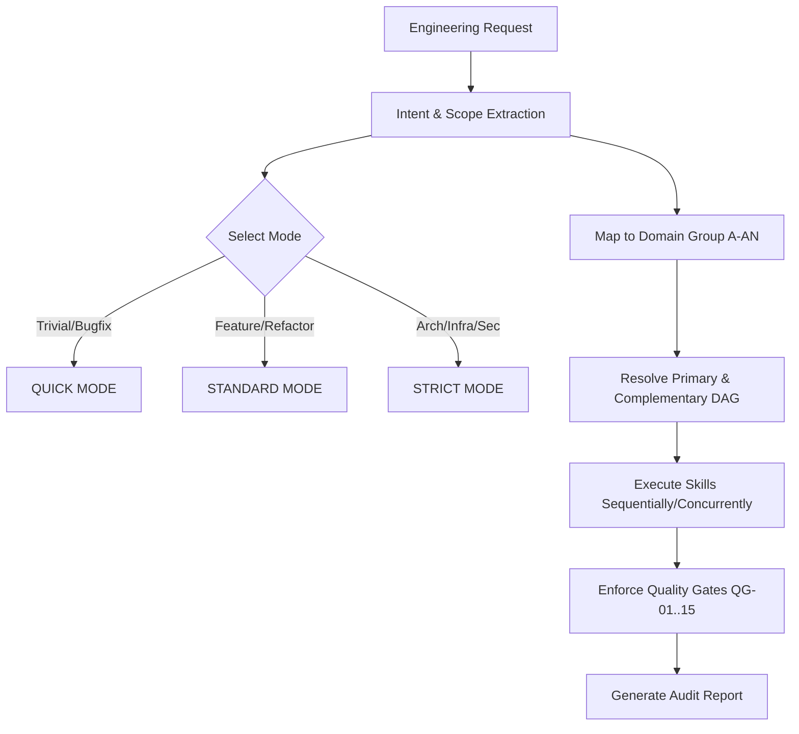

# DEX Engineering Skills Framework v10.0 — Dynamic Routing Matrix

> **Comprehensive Multi-Domain Dispatch Matrix for Master Orchestrator**  
> Covers 50 real-world engineering scenarios corresponding to Groups A through AX (500 Specialized Skills), detailing primary/complementary skill chains, execution modes, and mandatory Quality Gates.

---

## 1. Routing Engine Overview

The `dex-master-orchestrator` parses incoming developer prompts, extracts semantic intent, and resolves execution plans through a Directed Acyclic Graph (DAG) of specialized skills.

---

## 2. 50 Domain Benchmark Scenarios (Groups A to AX)

### Scenario A: Core Engineering Workflow & Git Governance (Group A)

- **Trigger / Problem Statement:** Thiết lập chuẩn hóa quy trình phát triển, phân nhánh Git an toàn, atomic commit và quản lý layout codebase.
- **Execution Mode:** `STANDARD`
- **Mandatory Quality Gates:** `QG-01`, `QG-02`, `QG-03`, `QG-08`
- **Primary Skills:**
  - [`dex-development-workflow`](.agents/skills/dex-development-workflow/SKILL.md)
  - [`dex-git-workflow`](.agents/skills/dex-git-workflow/SKILL.md)
  - [`dex-code-organization`](.agents/skills/dex-code-organization/SKILL.md)
- **Complementary Skills:**
  - [`dex-repository-bootstrap`](.agents/skills/dex-repository-bootstrap/SKILL.md)
  - [`dex-semantic-version-automation`](.agents/skills/dex-semantic-version-automation/SKILL.md)

---

### Scenario B: Multi-Agent Architecture & Coordination (Group B)

- **Trigger / Problem Statement:** Thiết kế kiến trúc hệ thống multi-agent orchestration có khả năng phân quyền và giám sát agent con.
- **Execution Mode:** `STRICT`
- **Mandatory Quality Gates:** `QG-01`, `QG-02`, `QG-05`, `QG-09`, `QG-13`
- **Primary Skills:**
  - [`dex-multi-agent-orchestration`](.agents/skills/dex-multi-agent-orchestration/SKILL.md)
  - [`dex-software-architecture`](.agents/skills/dex-software-architecture/SKILL.md)
  - [`dex-agent-engineering`](.agents/skills/dex-agent-engineering/SKILL.md)
- **Complementary Skills:**
  - [`dex-tool-calling-contracts`](.agents/skills/dex-tool-calling-contracts/SKILL.md)
  - [`dex-concurrency-state`](.agents/skills/dex-concurrency-state/SKILL.md)

---

### Scenario C: Production Reliability & Progressive Rollouts (Group C)

- **Trigger / Problem Statement:** Phân tích tác động thay đổi blast radius, cấu hình feature flags động và thiết lập ngân sách lỗi SLO.
- **Execution Mode:** `STRICT`
- **Mandatory Quality Gates:** `QG-01`, `QG-03`, `QG-07`, `QG-10`
- **Primary Skills:**
  - [`dex-change-impact-analysis`](.agents/skills/dex-change-impact-analysis/SKILL.md)
  - [`dex-feature-flags`](.agents/skills/dex-feature-flags/SKILL.md)
  - [`dex-reliability-engineering`](.agents/skills/dex-reliability-engineering/SKILL.md)
- **Complementary Skills:**
  - [`dex-zero-downtime-rollouts`](.agents/skills/dex-zero-downtime-rollouts/SKILL.md)
  - [`dex-production-monitoring`](.agents/skills/dex-production-monitoring/SKILL.md)

---

### Scenario D: Frontend Performance & Core Web Vitals (Group D)

- **Trigger / Problem Statement:** Tối ưu hóa Core Web Vitals, loại bỏ layout shift, và tự động hóa kiểm thử visual regression.
- **Execution Mode:** `STANDARD`
- **Mandatory Quality Gates:** `QG-02`, `QG-04`, `QG-07`, `QG-14`
- **Primary Skills:**
  - [`dex-frontend-performance`](.agents/skills/dex-frontend-performance/SKILL.md)
  - [`dex-visual-regression`](.agents/skills/dex-visual-regression/SKILL.md)
  - [`dex-forms-and-validation`](.agents/skills/dex-forms-and-validation/SKILL.md)
- **Complementary Skills:**
  - [`dex-accessibility-automation`](.agents/skills/dex-accessibility-automation/SKILL.md)
  - [`dex-design-handoff-verification`](.agents/skills/dex-design-handoff-verification/SKILL.md)

---

### Scenario E: Event-Driven Backend & Distributed Processing (Group E)

- **Trigger / Problem Statement:** Xây dựng đường ống event-driven bất đồng bộ với consumer xử lý bình thản idempotent và worker hàng đợi.
- **Execution Mode:** `STRICT`
- **Mandatory Quality Gates:** `QG-02`, `QG-04`, `QG-09`, `QG-10`
- **Primary Skills:**
  - [`dex-event-driven-architecture`](.agents/skills/dex-event-driven-architecture/SKILL.md)
  - [`dex-idempotent-operations`](.agents/skills/dex-idempotent-operations/SKILL.md)
  - [`dex-background-job-queues`](.agents/skills/dex-background-job-queues/SKILL.md)
- **Complementary Skills:**
  - [`dex-api-engineering`](.agents/skills/dex-api-engineering/SKILL.md)
  - [`dex-distributed-consistency`](.agents/skills/dex-distributed-consistency/SKILL.md)

---

### Scenario F: Data Contracts & Storage Optimization (Group F)

- **Trigger / Problem Statement:** Thực thi tương thích schema giữa producer/consumer dữ liệu và tối ưu hóa kế hoạch thực thi câu lệnh SQL.
- **Execution Mode:** `STANDARD`
- **Mandatory Quality Gates:** `QG-02`, `QG-04`, `QG-08`
- **Primary Skills:**
  - [`dex-data-contracts`](.agents/skills/dex-data-contracts/SKILL.md)
  - [`dex-data-pipelines`](.agents/skills/dex-data-pipelines/SKILL.md)
  - [`dex-database-query-plans`](.agents/skills/dex-database-query-plans/SKILL.md)
- **Complementary Skills:**
  - [`dex-database-engineering`](.agents/skills/dex-database-engineering/SKILL.md)
  - [`dex-schema-evolution`](.agents/skills/dex-schema-evolution/SKILL.md)

---

### Scenario G: Enterprise RAG & Retrieval Quality Engineering (Group G)

- **Trigger / Problem Statement:** Triển khai tìm kiếm lai dense/sparse, reranking mô hình cross-encoder và kiểm soát chi phí token LLM.
- **Execution Mode:** `STANDARD`
- **Mandatory Quality Gates:** `QG-02`, `QG-04`, `QG-07`, `QG-13`
- **Primary Skills:**
  - [`dex-rag-pipelines`](.agents/skills/dex-rag-pipelines/SKILL.md)
  - [`dex-retrieval-evaluation`](.agents/skills/dex-retrieval-evaluation/SKILL.md)
  - [`dex-llm-cost-controls`](.agents/skills/dex-llm-cost-controls/SKILL.md)
- **Complementary Skills:**
  - [`dex-llm-integration`](.agents/skills/dex-llm-integration/SKILL.md)
  - [`dex-reranking-strategies`](.agents/skills/dex-reranking-strategies/SKILL.md)

---

### Scenario H: Governed Monorepo & Cross-Platform Tooling (Group H)

- **Trigger / Problem Statement:** Chuẩn hóa monorepo đa dự án, phát triển CLI hiệu năng cao và tự động hóa phát hành semantic release.
- **Execution Mode:** `STANDARD`
- **Mandatory Quality Gates:** `QG-01`, `QG-02`, `QG-03`, `QG-05`
- **Primary Skills:**
  - [`dex-monorepo-governance`](.agents/skills/dex-monorepo-governance/SKILL.md)
  - [`dex-cli-engineering`](.agents/skills/dex-cli-engineering/SKILL.md)
  - [`dex-semantic-version-automation`](.agents/skills/dex-semantic-version-automation/SKILL.md)
- **Complementary Skills:**
  - [`dex-developer-tooling`](.agents/skills/dex-developer-tooling/SKILL.md)
  - [`dex-cicd-automation`](.agents/skills/dex-cicd-automation/SKILL.md)

---

### Scenario I: Threat Modeling & Defensive Secrets Lifecycle (Group I)

- **Trigger / Problem Statement:** Mô hình hóa mối đe dọa STRIDE, thiết lập kiểm soát truy cập zero-trust và quản lý vòng đời secrets leases.
- **Execution Mode:** `STRICT`
- **Mandatory Quality Gates:** `QG-01`, `QG-06`, `QG-08`, `QG-11`
- **Primary Skills:**
  - [`dex-threat-modeling`](.agents/skills/dex-threat-modeling/SKILL.md)
  - [`dex-secrets-management`](.agents/skills/dex-secrets-management/SKILL.md)
  - [`dex-security-audit`](.agents/skills/dex-security-audit/SKILL.md)
- **Complementary Skills:**
  - [`dex-auth-session-lifecycle`](.agents/skills/dex-auth-session-lifecycle/SKILL.md)
  - [`dex-access-control-tenancy`](.agents/skills/dex-access-control-tenancy/SKILL.md)

---

### Scenario J: Cloud-Native Containers & Kubernetes Orchestration (Group J)

- **Trigger / Problem Statement:** Đóng gói container OCI tối giản an toàn và triển khai rolling update Kubernetes zero-downtime.
- **Execution Mode:** `STRICT`
- **Mandatory Quality Gates:** `QG-01`, `QG-06`, `QG-07`, `QG-11`
- **Primary Skills:**
  - [`dex-container-image-engineering`](.agents/skills/dex-container-image-engineering/SKILL.md)
  - [`dex-kubernetes-deployment`](.agents/skills/dex-kubernetes-deployment/SKILL.md)
  - [`dex-zero-downtime-rollouts`](.agents/skills/dex-zero-downtime-rollouts/SKILL.md)
- **Complementary Skills:**
  - [`dex-service-mesh-networking`](.agents/skills/dex-service-mesh-networking/SKILL.md)
  - [`dex-kubernetes-policy-enforcement`](.agents/skills/dex-kubernetes-policy-enforcement/SKILL.md)

---

### Scenario K: Mobile Offline Synchronization & Native Device Access (Group K)

- **Trigger / Problem Statement:** Kiến trúc engine đồng bộ offline-first trên di động giải quyết xung đột và tích hợp phần cứng sinh trắc.
- **Execution Mode:** `STANDARD`
- **Mandatory Quality Gates:** `QG-02`, `QG-04`, `QG-08`
- **Primary Skills:**
  - [`dex-android-app-architecture`](.agents/skills/dex-android-app-architecture/SKILL.md)
  - [`dex-mobile-offline-sync`](.agents/skills/dex-mobile-offline-sync/SKILL.md)
  - [`dex-native-device-integration`](.agents/skills/dex-native-device-integration/SKILL.md)
- **Complementary Skills:**
  - [`dex-ios-app-architecture`](.agents/skills/dex-ios-app-architecture/SKILL.md)
  - [`dex-mobile-performance-profiling`](.agents/skills/dex-mobile-performance-profiling/SKILL.md)

---

### Scenario L: Compliance Control Mapping & Operational Readiness (Group L)

- **Trigger / Problem Statement:** Ánh xạ kiểm soát tuân thủ SOC 2/ISO 27001 thành bằng chứng tự động và đánh giá mức độ sẵn sàng vận hành.
- **Execution Mode:** `STRICT`
- **Mandatory Quality Gates:** `QG-01`, `QG-06`, `QG-08`, `QG-14`
- **Primary Skills:**
  - [`dex-operational-readiness-review`](.agents/skills/dex-operational-readiness-review/SKILL.md)
  - [`dex-compliance-control-mapping`](.agents/skills/dex-compliance-control-mapping/SKILL.md)
  - [`dex-privacy-impact-assessment`](.agents/skills/dex-privacy-impact-assessment/SKILL.md)
- **Complementary Skills:**
  - [`dex-audit-trail-integrity`](.agents/skills/dex-audit-trail-integrity/SKILL.md)
  - [`dex-configuration-drift`](.agents/skills/dex-configuration-drift/SKILL.md)

---

### Scenario M: Advanced Verification & Mutation Testing (Group M)

- **Trigger / Problem Statement:** Đo lường độ hiệu quả test bằng phân tích đột biến mutation survival, cách ly flaky test và kiểm chứng bất biến.
- **Execution Mode:** `STRICT`
- **Mandatory Quality Gates:** `QG-02`, `QG-04`, `QG-09`
- **Primary Skills:**
  - [`dex-mutation-testing`](.agents/skills/dex-mutation-testing/SKILL.md)
  - [`dex-flaky-test-remediation`](.agents/skills/dex-flaky-test-remediation/SKILL.md)
  - [`dex-coverage-risk-analysis`](.agents/skills/dex-coverage-risk-analysis/SKILL.md)
- **Complementary Skills:**
  - [`dex-differential-testing`](.agents/skills/dex-differential-testing/SKILL.md)
  - [`dex-formal-invariant-checks`](.agents/skills/dex-formal-invariant-checks/SKILL.md)

---

### Scenario N: Distributed Systems Resilience & Traffic Shaping (Group N)

- **Trigger / Problem Statement:** Mô phỏng áp lực tải đỉnh điểm, thiết kế thuật toán giới hạn tốc độ token bucket và cắt giảm tải backpressure.
- **Execution Mode:** `STRICT`
- **Mandatory Quality Gates:** `QG-03`, `QG-07`, `QG-10`
- **Primary Skills:**
  - [`dex-load-and-stress-testing`](.agents/skills/dex-load-and-stress-testing/SKILL.md)
  - [`dex-rate-limiting-quotas`](.agents/skills/dex-rate-limiting-quotas/SKILL.md)
  - [`dex-traffic-shaping-backpressure`](.agents/skills/dex-traffic-shaping-backpressure/SKILL.md)
- **Complementary Skills:**
  - [`dex-service-failover`](.agents/skills/dex-service-failover/SKILL.md)
  - [`dex-distributed-consistency`](.agents/skills/dex-distributed-consistency/SKILL.md)

---

### Scenario O: Cloud Platform Governance & GitOps Workflows (Group O)

- **Trigger / Problem Statement:** Kiểm toán phân quyền IAM đám mây, quản lý danh mục dịch vụ nội bộ và đối soát trạng thái khai báo GitOps.
- **Execution Mode:** `STRICT`
- **Mandatory Quality Gates:** `QG-01`, `QG-06`, `QG-11`
- **Primary Skills:**
  - [`dex-cloud-iam-policy-review`](.agents/skills/dex-cloud-iam-policy-review/SKILL.md)
  - [`dex-gitops-workflows`](.agents/skills/dex-gitops-workflows/SKILL.md)
  - [`dex-kubernetes-policy-enforcement`](.agents/skills/dex-kubernetes-policy-enforcement/SKILL.md)
- **Complementary Skills:**
  - [`dex-platform-service-catalog`](.agents/skills/dex-platform-service-catalog/SKILL.md)
  - [`dex-cloud-resource-tagging`](.agents/skills/dex-cloud-resource-tagging/SKILL.md)

---

### Scenario P: Specialized Language & Systems Runtime Diagnostics (Group P)

- **Trigger / Problem Statement:** Kiểm toán khối Rust unsafe ngừa UB, phân tích tạm dừng GC JVM và chẩn đoán độ trễ event loop Node.js.
- **Execution Mode:** `STRICT`
- **Mandatory Quality Gates:** `QG-02`, `QG-05`, `QG-12`
- **Primary Skills:**
  - [`dex-rust-unsafe-audit`](.agents/skills/dex-rust-unsafe-audit/SKILL.md)
  - [`dex-cpp-memory-safety`](.agents/skills/dex-cpp-memory-safety/SKILL.md)
  - [`dex-nodejs-runtime-diagnostics`](.agents/skills/dex-nodejs-runtime-diagnostics/SKILL.md)
- **Complementary Skills:**
  - [`dex-go-concurrency-patterns`](.agents/skills/dex-go-concurrency-patterns/SKILL.md)
  - [`dex-jvm-performance-diagnostics`](.agents/skills/dex-jvm-performance-diagnostics/SKILL.md)

---

### Scenario Q: Advanced Multi-Agent MCP Protocols & Vector Indexing (Group Q)

- **Trigger / Problem Statement:** Xây dựng MCP Server chuẩn hóa, tối ưu hóa chỉ mục vector HNSW và thực thi schema JSON phản hồi nghiêm ngặt.
- **Execution Mode:** `STANDARD`
- **Mandatory Quality Gates:** `QG-02`, `QG-04`, `QG-13`
- **Primary Skills:**
  - [`dex-mcp-server-design`](.agents/skills/dex-mcp-server-design/SKILL.md)
  - [`dex-vector-index-design`](.agents/skills/dex-vector-index-design/SKILL.md)
  - [`dex-reranking-strategies`](.agents/skills/dex-reranking-strategies/SKILL.md)
- **Complementary Skills:**
  - [`dex-structured-llm-output`](.agents/skills/dex-structured-llm-output/SKILL.md)
  - [`dex-agent-memory-governance`](.agents/skills/dex-agent-memory-governance/SKILL.md)

---

### Scenario R: User Experience Journey Mapping & Accessibility (Group R)

- **Trigger / Problem Statement:** Vẽ bản đồ luồng mua hàng, tự động hóa kiểm định WCAG 2.2 AA và xác minh bàn giao design tokens.
- **Execution Mode:** `STANDARD`
- **Mandatory Quality Gates:** `QG-02`, `QG-08`, `QG-14`
- **Primary Skills:**
  - [`dex-user-journey-mapping`](.agents/skills/dex-user-journey-mapping/SKILL.md)
  - [`dex-accessibility-automation`](.agents/skills/dex-accessibility-automation/SKILL.md)
  - [`dex-design-handoff-verification`](.agents/skills/dex-design-handoff-verification/SKILL.md)
- **Complementary Skills:**
  - [`dex-product-requirements-writing`](.agents/skills/dex-product-requirements-writing/SKILL.md)
  - [`dex-usability-study-design`](.agents/skills/dex-usability-study-design/SKILL.md)

---

### Scenario S: Application Security Defense & Supply Chain Verification (Group S)

- **Trigger / Problem Statement:** Sàng lọc cảnh báo SAST, ký số và xác minh SBOM tiền phát hành, gia cố bảo mật CSP tiện ích mở rộng trình duyệt.
- **Execution Mode:** `STRICT`
- **Mandatory Quality Gates:** `QG-01`, `QG-06`, `QG-08`, `QG-11`
- **Primary Skills:**
  - [`dex-sast-finding-triage`](.agents/skills/dex-sast-finding-triage/SKILL.md)
  - [`dex-sbom-verification`](.agents/skills/dex-sbom-verification/SKILL.md)
  - [`dex-browser-extension-hardening`](.agents/skills/dex-browser-extension-hardening/SKILL.md)
- **Complementary Skills:**
  - [`dex-api-abuse-prevention`](.agents/skills/dex-api-abuse-prevention/SKILL.md)
  - [`dex-cryptographic-api-review`](.agents/skills/dex-cryptographic-api-review/SKILL.md)

---

### Scenario T: Autonomous SkillOps Lifecycle & Provenance Auditing (Group T)

- **Trigger / Problem Statement:** Chỉ mục hóa toàn bộ catalog kỹ năng, quét an ninh AST động, chấm điểm độ chính xác điều phối và quản lý nguồn gốc upstream.
- **Execution Mode:** `STRICT`
- **Mandatory Quality Gates:** `QG-01`, `QG-02`, `QG-08`, `QG-15`
- **Primary Skills:**
  - [`dex-skill-discovery-indexer`](.agents/skills/dex-skill-discovery-indexer/SKILL.md)
  - [`dex-skill-security-screening`](.agents/skills/dex-skill-security-screening/SKILL.md)
  - [`dex-skill-upstream-sync`](.agents/skills/dex-skill-upstream-sync/SKILL.md)
- **Complementary Skills:**
  - [`dex-skill-quality-benchmarking`](.agents/skills/dex-skill-quality-benchmarking/SKILL.md)
  - [`dex-skill-dependency-graph`](.agents/skills/dex-skill-dependency-graph/SKILL.md)

---

### Scenario U: Visual Design Intelligence & Theme Systems (Group U)

- **Trigger / Problem Statement:** Thiết kế visual design brief synthesis, kiểm toán visual hierarchy audit và hệ thống color contrast systems.
- **Execution Mode:** `STANDARD`
- **Mandatory Quality Gates:** `QG-02`, `QG-08`, `QG-14`
- **Primary Skills:**
  - [`dex-design-brief-synthesis`](.agents/skills/dex-design-brief-synthesis/SKILL.md)
  - [`dex-visual-hierarchy-audit`](.agents/skills/dex-visual-hierarchy-audit/SKILL.md)
  - [`dex-color-contrast-systems`](.agents/skills/dex-color-contrast-systems/SKILL.md)
- **Complementary Skills:**
  - [`dex-fluid-typography-engineering`](.agents/skills/dex-fluid-typography-engineering/SKILL.md)
  - [`dex-layout-composition-patterns`](.agents/skills/dex-layout-composition-patterns/SKILL.md)

---

### Scenario V: Advanced Web Experiences & Offline Delivery (Group V)

- **Trigger / Problem Statement:** Tối ưu hóa web animation performance, xây dựng progressive web apps và danh sách virtualized infinite lists.
- **Execution Mode:** `STANDARD`
- **Mandatory Quality Gates:** `QG-02`, `QG-04`, `QG-07`, `QG-14`
- **Primary Skills:**
  - [`dex-web-animation-performance`](.agents/skills/dex-web-animation-performance/SKILL.md)
  - [`dex-progressive-web-apps`](.agents/skills/dex-progressive-web-apps/SKILL.md)
  - [`dex-virtualized-infinite-lists`](.agents/skills/dex-virtualized-infinite-lists/SKILL.md)
- **Complementary Skills:**
  - [`dex-web-canvas-rendering`](.agents/skills/dex-web-canvas-rendering/SKILL.md)
  - [`dex-hls-dash-playback`](.agents/skills/dex-hls-dash-playback/SKILL.md)

---

### Scenario W: Browser Extensions & CDP Automation (Group W)

- **Trigger / Problem Statement:** Phát triển browser extension mv3, bảo vệ extension message security và kiểm thử browser automation testing.
- **Execution Mode:** `STRICT`
- **Mandatory Quality Gates:** `QG-01`, `QG-02`, `QG-06`, `QG-08`
- **Primary Skills:**
  - [`dex-browser-extension-mv3`](.agents/skills/dex-browser-extension-mv3/SKILL.md)
  - [`dex-extension-message-security`](.agents/skills/dex-extension-message-security/SKILL.md)
  - [`dex-browser-automation-testing`](.agents/skills/dex-browser-automation-testing/SKILL.md)
- **Complementary Skills:**
  - [`dex-extension-background-lifecycle`](.agents/skills/dex-extension-background-lifecycle/SKILL.md)
  - [`dex-cdp-observability`](.agents/skills/dex-cdp-observability/SKILL.md)

---

### Scenario X: Authorized Reverse Engineering & Binary Inspection (Group X)

- **Trigger / Problem Statement:** Kiểm tra cấu trúc pe elf structure inspection, ánh xạ native symbol mapping và phân tích disassembly cfg reconstruction.
- **Execution Mode:** `STRICT`
- **Mandatory Quality Gates:** `QG-01`, `QG-03`, `QG-06`, `QG-12`
- **Primary Skills:**
  - [`dex-pe-elf-structure-inspection`](.agents/skills/dex-pe-elf-structure-inspection/SKILL.md)
  - [`dex-native-symbol-mapping`](.agents/skills/dex-native-symbol-mapping/SKILL.md)
  - [`dex-disassembly-cfg-reconstruction`](.agents/skills/dex-disassembly-cfg-reconstruction/SKILL.md)
- **Complementary Skills:**
  - [`dex-managed-assembly-inspection`](.agents/skills/dex-managed-assembly-inspection/SKILL.md)
  - [`dex-reverse-evidence-chain`](.agents/skills/dex-reverse-evidence-chain/SKILL.md)

---

### Scenario Y: Protocols, Webhooks & Real-Time Messaging (Group Y)

- **Trigger / Problem Statement:** Cấu hình mqtt client reliability, khôi phục websocket session recovery và xác thực webhook signature validation.
- **Execution Mode:** `STRICT`
- **Mandatory Quality Gates:** `QG-02`, `QG-04`, `QG-06`, `QG-10`
- **Primary Skills:**
  - [`dex-mqtt-client-reliability`](.agents/skills/dex-mqtt-client-reliability/SKILL.md)
  - [`dex-websocket-session-recovery`](.agents/skills/dex-websocket-session-recovery/SKILL.md)
  - [`dex-webhook-signature-validation`](.agents/skills/dex-webhook-signature-validation/SKILL.md)
- **Complementary Skills:**
  - [`dex-http-client-connection-pooling`](.agents/skills/dex-http-client-connection-pooling/SKILL.md)
  - [`dex-service-contract-simulation`](.agents/skills/dex-service-contract-simulation/SKILL.md)

---

### Scenario Z: AI Agent Operations & Red Teaming (Group Z)

- **Trigger / Problem Statement:** Thiết kế llm evaluation dataset design, thẩm định agent task planning validation và cổng duyệt llm human review gates.
- **Execution Mode:** `STRICT`
- **Mandatory Quality Gates:** `QG-02`, `QG-04`, `QG-09`, `QG-13`
- **Primary Skills:**
  - [`dex-llm-evaluation-dataset-design`](.agents/skills/dex-llm-evaluation-dataset-design/SKILL.md)
  - [`dex-agent-task-planning-validation`](.agents/skills/dex-agent-task-planning-validation/SKILL.md)
  - [`dex-llm-human-review-gates`](.agents/skills/dex-llm-human-review-gates/SKILL.md)
- **Complementary Skills:**
  - [`dex-agent-trace-replay`](.agents/skills/dex-agent-trace-replay/SKILL.md)
  - [`dex-ai-safety-red-teaming`](.agents/skills/dex-ai-safety-red-teaming/SKILL.md)

---

### Scenario AA: Advanced Data Analytics & Anomaly Detection (Group AA)

- **Trigger / Problem Statement:** Xây dựng sql metric semantic layer, phát hiện data anomaly detection và tối ưu chi phí data warehouse cost tuning.
- **Execution Mode:** `STANDARD`
- **Mandatory Quality Gates:** `QG-02`, `QG-04`, `QG-07`, `QG-08`
- **Primary Skills:**
  - [`dex-sql-metric-semantic-layer`](.agents/skills/dex-sql-metric-semantic-layer/SKILL.md)
  - [`dex-data-anomaly-detection`](.agents/skills/dex-data-anomaly-detection/SKILL.md)
  - [`dex-data-warehouse-cost-tuning`](.agents/skills/dex-data-warehouse-cost-tuning/SKILL.md)
- **Complementary Skills:**
  - [`dex-geospatial-data-pipelines`](.agents/skills/dex-geospatial-data-pipelines/SKILL.md)
  - [`dex-stream-processing-semantics`](.agents/skills/dex-stream-processing-semantics/SKILL.md)

---

### Scenario AB: Native Systems, Graphics & Simulation (Group AB)

- **Trigger / Problem Statement:** Kiểm thử chess engine search testing, đảm bảo simulation determinism và tinh chỉnh game loop timing.
- **Execution Mode:** `STRICT`
- **Mandatory Quality Gates:** `QG-02`, `QG-05`, `QG-07`, `QG-12`
- **Primary Skills:**
  - [`dex-chess-engine-search-testing`](.agents/skills/dex-chess-engine-search-testing/SKILL.md)
  - [`dex-simulation-determinism`](.agents/skills/dex-simulation-determinism/SKILL.md)
  - [`dex-game-loop-timing`](.agents/skills/dex-game-loop-timing/SKILL.md)
- **Complementary Skills:**
  - [`dex-webgpu-rendering-fundamentals`](.agents/skills/dex-webgpu-rendering-fundamentals/SKILL.md)
  - [`dex-gpu-shader-profiling`](.agents/skills/dex-gpu-shader-profiling/SKILL.md)

---

### Scenario AC: Software Trust, Licensing & Reproducible Distribution (Group AC)

- **Trigger / Problem Statement:** Quét giấy phép open source license scanning, ký số artifact signature verification và quy trình code signing release process.
- **Execution Mode:** `STRICT`
- **Mandatory Quality Gates:** `QG-01`, `QG-06`, `QG-08`, `QG-15`
- **Primary Skills:**
  - [`dex-open-source-license-scanning`](.agents/skills/dex-open-source-license-scanning/SKILL.md)
  - [`dex-artifact-signature-verification`](.agents/skills/dex-artifact-signature-verification/SKILL.md)
  - [`dex-code-signing-release-process`](.agents/skills/dex-code-signing-release-process/SKILL.md)
- **Complementary Skills:**
  - [`dex-software-update-trust-chains`](.agents/skills/dex-software-update-trust-chains/SKILL.md)
  - [`dex-release-reproducibility-audit`](.agents/skills/dex-release-reproducibility-audit/SKILL.md)

---

### Scenario AD: Advanced SkillOps Governance & Drift Prevention (Group AD)

- **Trigger / Problem Statement:** Quản trị skill catalog taxonomy, kiểm tra skill source integrity và ghi nhận sổ cái skill execution evidence ledger.
- **Execution Mode:** `STRICT`
- **Mandatory Quality Gates:** `QG-01`, `QG-02`, `QG-08`, `QG-15`
- **Primary Skills:**
  - [`dex-skill-catalog-taxonomy`](.agents/skills/dex-skill-catalog-taxonomy/SKILL.md)
  - [`dex-skill-source-integrity`](.agents/skills/dex-skill-source-integrity/SKILL.md)
  - [`dex-skill-execution-evidence-ledger`](.agents/skills/dex-skill-execution-evidence-ledger/SKILL.md)
- **Complementary Skills:**
  - [`dex-skill-routing-conflict-tests`](.agents/skills/dex-skill-routing-conflict-tests/SKILL.md)
  - [`dex-skill-documentation-drift`](.agents/skills/dex-skill-documentation-drift/SKILL.md)

---

### Scenario AE: Enterprise Architecture & Migration (Group AE)

- **Trigger / Problem Statement:** Ghi nhận architecture decision records cho thiết kế modular monolith boundaries và chiến lược migration legacy strangler migration.
- **Execution Mode:** STRICT
- **Mandatory Quality Gates:** QG-01, QG-02, QG-04, QG-08, QG-13
- **Primary Skills:**
  - [dex-architecture-decision-records](.agents/skills/dex-architecture-decision-records/SKILL.md)
  - [dex-modular-monolith-boundaries](.agents/skills/dex-modular-monolith-boundaries/SKILL.md)
  - [dex-legacy-strangler-migration](.agents/skills/dex-legacy-strangler-migration/SKILL.md)
- **Complementary Skills:**
  - [dex-saga-compensation-workflows](.agents/skills/dex-saga-compensation-workflows/SKILL.md)
  - [dex-contract-first-development](.agents/skills/dex-contract-first-development/SKILL.md)

---

### Scenario AF: Advanced Distributed Systems & Resilience (Group AF)

- **Trigger / Problem Statement:** Xử lý message poison queue recovery, đảm bảo distributed lock lease safety và kiểm soát consumer lag control trong distributed systems.
- **Execution Mode:** STRICT
- **Mandatory Quality Gates:** QG-02, QG-05, QG-09, QG-14
- **Primary Skills:**
  - [dex-message-poison-queue-recovery](.agents/skills/dex-message-poison-queue-recovery/SKILL.md)
  - [dex-distributed-lock-lease-safety](.agents/skills/dex-distributed-lock-lease-safety/SKILL.md)
  - [dex-consumer-lag-control](.agents/skills/dex-consumer-lag-control/SKILL.md)
- **Complementary Skills:**
  - [dex-exactly-once-claims-audit](.agents/skills/dex-exactly-once-claims-audit/SKILL.md)
  - [dex-partition-fault-simulation](.agents/skills/dex-partition-fault-simulation/SKILL.md)

---

### Scenario AG: Applied AI & Foundation Model Systems (Group AG)

- **Trigger / Problem Statement:** Thiết lập pipeline rag freshness control, chuẩn bị embedding data preparation và kiểm soát context window budgeting cho LLM.
- **Execution Mode:** STANDARD
- **Mandatory Quality Gates:** QG-01, QG-03, QG-07, QG-10
- **Primary Skills:**
  - [dex-rag-freshness-control](.agents/skills/dex-rag-freshness-control/SKILL.md)
  - [dex-embedding-data-preparation](.agents/skills/dex-embedding-data-preparation/SKILL.md)
  - [dex-context-window-budgeting](.agents/skills/dex-context-window-budgeting/SKILL.md)
- **Complementary Skills:**
  - [dex-hybrid-search-fusion](.agents/skills/dex-hybrid-search-fusion/SKILL.md)
  - [dex-model-output-calibration](.agents/skills/dex-model-output-calibration/SKILL.md)

---

### Scenario AH: Extended Polyglot Engineering (Group AH)

- **Trigger / Problem Statement:** Biên dịch dự án kotlin multiplatform builds, gỡ lỗi dart flutter state debugging và xây dựng hệ thống zig build engineering.
- **Execution Mode:** STANDARD
- **Mandatory Quality Gates:** QG-02, QG-06, QG-11, QG-15
- **Primary Skills:**
  - [dex-kotlin-multiplatform-builds](.agents/skills/dex-kotlin-multiplatform-builds/SKILL.md)
  - [dex-dart-flutter-state-debugging](.agents/skills/dex-dart-flutter-state-debugging/SKILL.md)
  - [dex-zig-build-engineering](.agents/skills/dex-zig-build-engineering/SKILL.md)
- **Complementary Skills:**
  - [dex-swift-concurrency-review](.agents/skills/dex-swift-concurrency-review/SKILL.md)
  - [dex-ruby-gem-engineering](.agents/skills/dex-ruby-gem-engineering/SKILL.md)

---

### Scenario AI: Advanced UI/UX & Specialized Interfaces (Group AI)

- **Trigger / Problem Statement:** Di chuyển design token migration, bố trí high density dashboard layout và đảm bảo chart visualization accessibility.
- **Execution Mode:** STANDARD
- **Mandatory Quality Gates:** QG-01, QG-03, QG-07, QG-12
- **Primary Skills:**
  - [dex-design-token-migration](.agents/skills/dex-design-token-migration/SKILL.md)
  - [dex-high-density-dashboard-layout](.agents/skills/dex-high-density-dashboard-layout/SKILL.md)
  - [dex-chart-visualization-accessibility](.agents/skills/dex-chart-visualization-accessibility/SKILL.md)
- **Complementary Skills:**
  - [dex-component-state-matrix](.agents/skills/dex-component-state-matrix/SKILL.md)
  - [dex-perceived-performance-patterns](.agents/skills/dex-perceived-performance-patterns/SKILL.md)

---

### Scenario AJ: Authorized Software & System Inspection (Group AJ)

- **Trigger / Problem Statement:** Đối soát binary provenance matching, tương quan debug symbols correlation và lập báo cáo reverse engineering reporting.
- **Execution Mode:** STRICT
- **Mandatory Quality Gates:** QG-01, QG-08, QG-10, QG-15
- **Primary Skills:**
  - [dex-binary-provenance-matching](.agents/skills/dex-binary-provenance-matching/SKILL.md)
  - [dex-debug-symbols-correlation](.agents/skills/dex-debug-symbols-correlation/SKILL.md)
  - [dex-reverse-engineering-reporting](.agents/skills/dex-reverse-engineering-reporting/SKILL.md)
- **Complementary Skills:**
  - [dex-sbom-binary-correlation](.agents/skills/dex-sbom-binary-correlation/SKILL.md)
  - [dex-toolchain-reproducibility-audit](.agents/skills/dex-toolchain-reproducibility-audit/SKILL.md)

---

### Scenario AK: ML Platform & Production Engineering (Group AK)

- **Trigger / Problem Statement:** Đảm bảo tính tái lập ml experiment reproducibility, triển khai model serving canary rollouts và tối ưu batch inference pipeline tuning.
- **Execution Mode:** STRICT
- **Mandatory Quality Gates:** QG-02, QG-05, QG-09, QG-14
- **Primary Skills:**
  - [dex-ml-experiment-reproducibility](.agents/skills/dex-ml-experiment-reproducibility/SKILL.md)
  - [dex-model-serving-canary-rollouts](.agents/skills/dex-model-serving-canary-rollouts/SKILL.md)
  - [dex-batch-inference-pipeline-tuning](.agents/skills/dex-batch-inference-pipeline-tuning/SKILL.md)
- **Complementary Skills:**
  - [dex-online-offline-feature-parity](.agents/skills/dex-online-offline-feature-parity/SKILL.md)
  - [dex-vector-embedding-migration](.agents/skills/dex-vector-embedding-migration/SKILL.md)

---

### Scenario AL: Developer Platform & Polyglot Tooling (Group AL)

- **Trigger / Problem Statement:** Điều phối polyglot build orchestration, khởi tạo reproducible devcontainers và kiểm thử cross language contract tests.
- **Execution Mode:** STANDARD
- **Mandatory Quality Gates:** QG-01, QG-04, QG-06, QG-11
- **Primary Skills:**
  - [dex-polyglot-build-orchestration](.agents/skills/dex-polyglot-build-orchestration/SKILL.md)
  - [dex-reproducible-devcontainers](.agents/skills/dex-reproducible-devcontainers/SKILL.md)
  - [dex-cross-language-contract-tests](.agents/skills/dex-cross-language-contract-tests/SKILL.md)
- **Complementary Skills:**
  - [dex-cli-command-contracts](.agents/skills/dex-cli-command-contracts/SKILL.md)
  - [dex-build-cache-integrity](.agents/skills/dex-build-cache-integrity/SKILL.md)

---

### Scenario AM: Advanced Application & Infrastructure Security (Group AM)

- **Trigger / Problem Statement:** Thiết lập xác thực secretless cicd oidc, kiểm thử api authorization matrix tests và cô lập container runtime isolation.
- **Execution Mode:** STRICT
- **Mandatory Quality Gates:** QG-01, QG-08, QG-10, QG-15
- **Primary Skills:**
  - [dex-secretless-cicd-oidc](.agents/skills/dex-secretless-cicd-oidc/SKILL.md)
  - [dex-api-authorization-matrix-tests](.agents/skills/dex-api-authorization-matrix-tests/SKILL.md)
  - [dex-container-runtime-isolation](.agents/skills/dex-container-runtime-isolation/SKILL.md)
- **Complementary Skills:**
  - [dex-ephemeral-test-credentials](.agents/skills/dex-ephemeral-test-credentials/SKILL.md)
  - [dex-service-account-lifecycle](.agents/skills/dex-service-account-lifecycle/SKILL.md)

---

### Scenario AN: SkillOps Quality, Governance & Interoperability (Group AN)

- **Trigger / Problem Statement:** Đánh giá skill quality scorecards, kiểm thử agent skills spec compatibility và đo lường semantic routing evaluations.
- **Execution Mode:** STRICT
- **Mandatory Quality Gates:** QG-01, QG-02, QG-08, QG-15
- **Primary Skills:**
  - [dex-skill-quality-scorecards](.agents/skills/dex-skill-quality-scorecards/SKILL.md)
  - [dex-agent-skills-spec-compatibility](.agents/skills/dex-agent-skills-spec-compatibility/SKILL.md)
  - [dex-semantic-routing-evaluations](.agents/skills/dex-semantic-routing-evaluations/SKILL.md)
- **Complementary Skills:**
  - [dex-skill-catalog-reconciliation](.agents/skills/dex-skill-catalog-reconciliation/SKILL.md)
  - [dex-skill-example-test-fixtures](.agents/skills/dex-skill-example-test-fixtures/SKILL.md)

---

## 3. Segregated Upstream Integration Routing Pathways

Third-party integrations in `integrations/` are coordinated through `dex-master-orchestrator` as delegated leaf capabilities, never overriding root orchestration rules.

---

### Scenario INT-E: Supabase PostgreSQL & Row-Level Security Optimization (Source E)

- **Trigger / Problem Statement:** Thiết kế, tối ưu hóa CSDL Supabase BaaS, khắc phục cạn kiệt connection pooler Supavisor/PgBouncer (port 5432 vs 6543), tối ưu hóa RLS subquery `(select auth.uid())` và kiểm toán hàm `SECURITY DEFINER`.
- **Execution Mode:** `STRICT`
- **Mandatory Quality Gates:** `QG-01`, `QG-02`, `QG-03`, `QG-08`, `QG-15`
- **Primary Skills:**
  - [`dex-database-engineering`](.agents/skills/dex-database-engineering/SKILL.md)
  - [`dex-database-query-plans`](.agents/skills/dex-database-query-plans/SKILL.md)
  - [`dex-supabase-adapter`](integrations/supabase/dex-supabase-adapter/SKILL.md)
- **Complementary Skills:**
  - [`dex-access-control-tenancy`](.agents/skills/dex-access-control-tenancy/SKILL.md)
  - [`dex-auth-session-lifecycle`](.agents/skills/dex-auth-session-lifecycle/SKILL.md)

---

### Scenario INT-F: Disciplined Test-Driven Development & Git Worktree Isolation (Source F)

- **Trigger / Problem Statement:** Phát triển tính năng theo chu trình TDD nghiêm ngặt (Red-Green-Refactor), thiết lập atomic checklist có tiêu chí kiểm chứng sau mỗi bước nhỏ, và cô lập không gian làm việc bằng Git Worktree.
- **Execution Mode:** `STANDARD`
- **Mandatory Quality Gates:** `QG-01`, `QG-02`, `QG-06`, `QG-08`
- **Primary Skills:**
  - [`dex-development-workflow`](.agents/skills/dex-development-workflow/SKILL.md)
  - [`dex-testing-engineering`](.agents/skills/dex-testing-engineering/SKILL.md)
  - [`dex-superpowers-adapter`](integrations/superpowers/dex-superpowers-adapter/SKILL.md)
- **Complementary Skills:**
  - [`dex-git-workflow`](.agents/skills/dex-git-workflow/SKILL.md)
  - [`dex-code-verification`](.agents/skills/dex-code-verification/SKILL.md)

---

### Scenario INT-G: Hypothesis-Driven Bug Diagnosis & Specification Decomposition (Source G)

- **Trigger / Problem Statement:** Chẩn đoán lỗi hóc búa/flaky bug bằng test harness tối thiểu, đặt giả thuyết có thể bác bỏ được, phân rã đặc tả thành các thẻ công việc nguyên tử (`to-tickets`), và lưu trữ ngữ cảnh ca làm việc (`handoff.md`).
- **Execution Mode:** `STANDARD`
- **Mandatory Quality Gates:** `QG-01`, `QG-02`, `QG-03`, `QG-08`
- **Primary Skills:**
  - [`dex-root-cause-debugging`](.agents/skills/dex-root-cause-debugging/SKILL.md)
  - [`dex-specification-driven`](.agents/skills/dex-specification-driven/SKILL.md)
  - [`dex-mattpocock-adapter`](integrations/mattpocock/dex-mattpocock-adapter/SKILL.md)
- **Complementary Skills:**
  - [`dex-task-delegation`](.agents/skills/dex-task-delegation/SKILL.md)
  - [`dex-context-engineering`](.agents/skills/dex-context-engineering/SKILL.md)

---

### Scenario AO: Supabase & Advanced PostgreSQL RLS Isolation (Group AO)

- **Trigger / Problem Statement:** Verify and enforce multi-tenant PostgreSQL Row Level Security (RLS) policies and storage isolation rules under high-concurrency client mutations.
- **Execution Mode:** `STRICT`
- **Mandatory Quality Gates:** `QG-01`, `QG-04`, `QG-06`, `QG-10`
- **Primary Skills:**
  - [`dex-postgres-rls-policy-verification`](.agents/skills/dex-postgres-rls-policy-verification/SKILL.md)
  - [`dex-supabase-storage-access-policies`](.agents/skills/dex-supabase-storage-access-policies/SKILL.md)
- **Complementary Skills:**
  - [`dex-database-engineering`](.agents/skills/dex-database-engineering/SKILL.md)
  - [`dex-access-control-tenancy`](.agents/skills/dex-access-control-tenancy/SKILL.md)

---

### Scenario AP: Autonomous Agent Safety & Execution Budgets (Group AP)

- **Trigger / Problem Statement:** Configure strict tool invocation scopes, execution budgets, checkpoint rollbacks, and independent reviewer validation for autonomous coding agents.
- **Execution Mode:** `STRICT`
- **Mandatory Quality Gates:** `QG-01`, `QG-06`, `QG-10`, `QG-12`
- **Primary Skills:**
  - [`dex-agent-tool-permission-modeling`](.agents/skills/dex-agent-tool-permission-modeling/SKILL.md)
  - [`dex-agent-execution-budget-controls`](.agents/skills/dex-agent-execution-budget-controls/SKILL.md)
  - [`dex-agent-shutdown-and-cancellation`](.agents/skills/dex-agent-shutdown-and-cancellation/SKILL.md)
- **Complementary Skills:**
  - [`dex-agent-reviewer-independence`](.agents/skills/dex-agent-reviewer-independence/SKILL.md)
  - [`dex-multi-agent-orchestration`](.agents/skills/dex-multi-agent-orchestration/SKILL.md)

---

### Scenario AQ: Streaming Media & Manifest Validation (Group AQ)

- **Trigger / Problem Statement:** Validate, audit, and debug HLS (m3u8) and MPEG-DASH (mpd) streaming manifests, verifying segment sequencing, discontinuity tags, and video transcoding ladders.
- **Execution Mode:** `STANDARD`
- **Mandatory Quality Gates:** `QG-01`, `QG-03`, `QG-05`, `QG-07`
- **Primary Skills:**
  - [`dex-streaming-manifest-validation`](.agents/skills/dex-streaming-manifest-validation/SKILL.md)
  - [`dex-video-transcoding-ladders`](.agents/skills/dex-video-transcoding-ladders/SKILL.md)
- **Complementary Skills:**
  - [`dex-media-metadata-normalization`](.agents/skills/dex-media-metadata-normalization/SKILL.md)
  - [`dex-performance-optimization`](.agents/skills/dex-performance-optimization/SKILL.md)

---

### Scenario AR: Chess & Native Performance Engineering (Group AR)

- **Trigger / Problem Statement:** Verify UCI protocol compliance, validate legal move generation via Perft node enumeration, and enforce Transposition Table Zobrist hash correctness.
- **Execution Mode:** `STRICT`
- **Mandatory Quality Gates:** `QG-01`, `QG-03`, `QG-05`, `QG-09`
- **Primary Skills:**
  - [`dex-chess-uci-protocol-compliance`](.agents/skills/dex-chess-uci-protocol-compliance/SKILL.md)
  - [`dex-chess-legal-movegen-perft`](.agents/skills/dex-chess-legal-movegen-perft/SKILL.md)
  - [`dex-chess-transposition-table-correctness`](.agents/skills/dex-chess-transposition-table-correctness/SKILL.md)
- **Complementary Skills:**
  - [`dex-chess-search-pruning-evals`](.agents/skills/dex-chess-search-pruning-evals/SKILL.md)
  - [`dex-chess-nnue-evaluation-integration`](.agents/skills/dex-chess-nnue-evaluation-integration/SKILL.md)

---

### Scenario AS: Windows & Desktop Systems Engineering (Group AS)

- **Trigger / Problem Statement:** Reproduce and fix Win32 per-monitor DPI coordinate translation defects, layout scaling, and Windows COM interop boundaries.
- **Execution Mode:** `STANDARD`
- **Mandatory Quality Gates:** `QG-01`, `QG-03`, `QG-05`, `QG-08`
- **Primary Skills:**
  - [`dex-win32-dpi-multi-monitor-layout`](.agents/skills/dex-win32-dpi-multi-monitor-layout/SKILL.md)
  - [`dex-windows-com-interop`](.agents/skills/dex-windows-com-interop/SKILL.md)
- **Complementary Skills:**
  - [`dex-desktop-ipc-design`](.agents/skills/dex-desktop-ipc-design/SKILL.md)
  - [`dex-cli-engineering`](.agents/skills/dex-cli-engineering/SKILL.md)

---

### Scenario AT: Platform Resilience & Infrastructure Security (Group AT)

- **Trigger / Problem Statement:** Manage Kubernetes pod secret delivery, automated credential rotation, and validate Terraform infrastructure modules against contract tests.
- **Execution Mode:** `STRICT`
- **Mandatory Quality Gates:** `QG-01`, `QG-04`, `QG-06`, `QG-10`
- **Primary Skills:**
  - [`dex-kubernetes-secret-delivery`](.agents/skills/dex-kubernetes-secret-delivery/SKILL.md)
  - [`dex-terraform-module-contract-tests`](.agents/skills/dex-terraform-module-contract-tests/SKILL.md)
- **Complementary Skills:**
  - [`dex-cloud-network-design`](.agents/skills/dex-cloud-network-design/SKILL.md)
  - [`dex-secrets-management`](.agents/skills/dex-secrets-management/SKILL.md)

---

### Scenario AU: Product Experience & Design Systems Evaluation (Group AU)

- **Trigger / Problem Statement:** Critique UI visual hierarchy, usability, color contrast, and typographic scales against verified design system tokens.
- **Execution Mode:** `STANDARD`
- **Mandatory Quality Gates:** `QG-01`, `QG-03`, `QG-07`, `QG-14`
- **Primary Skills:**
  - [`dex-design-critique-rubric`](.agents/skills/dex-design-critique-rubric/SKILL.md)
  - [`dex-design-reference-evaluation`](.agents/skills/dex-design-reference-evaluation/SKILL.md)
- **Complementary Skills:**
  - [`dex-design-system-tokens`](.agents/skills/dex-design-system-tokens/SKILL.md)
  - [`dex-accessibility-automation`](.agents/skills/dex-accessibility-automation/SKILL.md)

---

### Scenario AV: Advanced TypeScript & Full Stack Packaging (Group AV)

- **Trigger / Problem Statement:** Verify dual-publishing of ESM and CommonJS TypeScript packages, diagnose Next.js App Router cache invalidations, and enforce React Server Component boundaries.
- **Execution Mode:** `STANDARD`
- **Mandatory Quality Gates:** `QG-01`, `QG-03`, `QG-05`, `QG-08`
- **Primary Skills:**
  - [`dex-typescript-package-dual-publish`](.agents/skills/dex-typescript-package-dual-publish/SKILL.md)
  - [`dex-nextjs-app-router-data-cache`](.agents/skills/dex-nextjs-app-router-data-cache/SKILL.md)
  - [`dex-react-server-component-boundaries`](.agents/skills/dex-react-server-component-boundaries/SKILL.md)
- **Complementary Skills:**
  - [`dex-frontend-data-flow`](.agents/skills/dex-frontend-data-flow/SKILL.md)
  - [`dex-contract-first-development`](.agents/skills/dex-contract-first-development/SKILL.md)

---

### Scenario AW: Security, Privacy & SLSA Governance (Group AW)

- **Trigger / Problem Statement:** Enforce SLSA Level 3 build provenance attestation, subject digest verification, data classification boundaries, and coordinated vulnerability disclosure.
- **Execution Mode:** `STRICT`
- **Mandatory Quality Gates:** `QG-01`, `QG-06`, `QG-10`, `QG-15`
- **Primary Skills:**
  - [`dex-dependency-provenance-attestation`](.agents/skills/dex-dependency-provenance-attestation/SKILL.md)
  - [`dex-build-slsa-controls`](.agents/skills/dex-build-slsa-controls/SKILL.md)
  - [`dex-data-classification-enforcement`](.agents/skills/dex-data-classification-enforcement/SKILL.md)
- **Complementary Skills:**
  - [`dex-open-source-license-scanning`](.agents/skills/dex-open-source-license-scanning/SKILL.md)
  - [`dex-artifact-signature-verification`](.agents/skills/dex-artifact-signature-verification/SKILL.md)

---

### Scenario AX: SkillOps Intelligence & Scalability (Group AX)

- **Trigger / Problem Statement:** Resolve skill conflict precedence across overlapping domain workflows, revalidate upstream skill provenance, and publish verified lifecycle health dashboards.
- **Execution Mode:** `STRICT`
- **Mandatory Quality Gates:** `QG-01`, `QG-06`, `QG-11`, `QG-13`
- **Primary Skills:**
  - [`dex-skill-conflict-precedence`](.agents/skills/dex-skill-conflict-precedence/SKILL.md)
  - [`dex-skill-lifecycle-health-dashboard`](.agents/skills/dex-skill-lifecycle-health-dashboard/SKILL.md)
  - [`dex-skill-provenance-revalidation`](.agents/skills/dex-skill-provenance-revalidation/SKILL.md)
- **Complementary Skills:**
  - [`dex-skill-crosshost-fixture-tests`](.agents/skills/dex-skill-crosshost-fixture-tests/SKILL.md)
  - [`dex-skill-evaluation-benchmarks`](.agents/skills/dex-skill-evaluation-benchmarks/SKILL.md)

---
