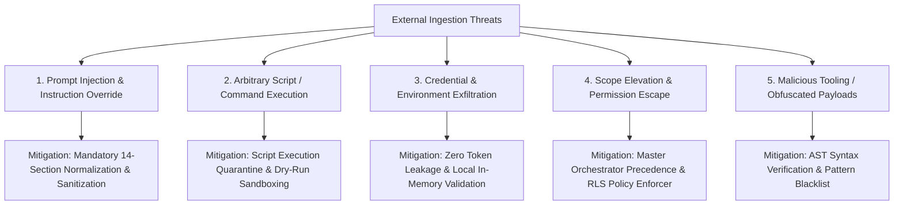

# DEX Security Audit & Threat Assessment for External Skill Ingestion

**Date:** October 22, 2026  
**Auditor:** Principal AI Agent Architect & Staff Security Engineer  
**Scope:** Ingestion of External Skills from GitHub Repositories (Sources A, B, C)  
**Standard:** NIST SP 800-218 (SSDF), OWASP Top 10 for LLM Applications (2025)  

---

## 1. Threat Modeling for External Skill Ingestion

Integrating third-party agent skills introduces unique attack vectors that traditional static analysis tools miss:

---

## 2. Risk Categorization of Candidate Sources

### Source A: Agentic Awesome Skills (`sickn33/agentic-awesome-skills`)
- **Risk Level:** **LOW-MEDIUM**
- **Potential Threat:** Massive volume with community contributions; risk of unvetted or low-quality prompts, broken markdown links, or accidental commands like `rm -rf`.
- **Enforced Guardrails:**
  - Strict pattern matching rejecting unquoted shell variables and arbitrary `curl | bash` one-liners.
  - Manual review required before import.

### Source B: Reverse Skill (`zhaoxuya520/reverse-skill`)
- **Risk Level:** **HIGH (Controlled)**
- **Potential Threat:** Contains offensive security playbooks, exploit payload references, and penetration testing workflows designed for authorized red-teaming. If unmonitored, an agent could attempt unauthorized network scanning or binary payload execution.
- **Enforced Guardrails:**
  - **Offensive Content Exclusion:** All exploit generation, sandbox escape, and privilege escalation playbooks are strictly quarantined and rejected.
  - **Defensive Scope Restriction:** Only non-destructive, static inspection skills (`dex-binary-inspection`, `dex-javascript-bundle-deobfuscation`) are allowed.
  - **Mandatory Safe Boundaries:** Skills must state that they run strictly on user-owned or authorized local artifacts with explicit scope boundaries.

### Source C: Reverse Engineer Anything - REA (`morluto/rea`)
- **Risk Level:** **MEDIUM**
- **Potential Threat:** Dispatches commands to local reverse-engineering tools (Ghidra, Hopper, IDA, objdump).
- **Enforced Guardrails:**
  - **MCP Adapter Pattern:** DEX does not execute REA internals directly. It defines `dex-rea-adapter`, which interfaces strictly via standard Model Context Protocol (MCP) tool schemas.
  - **Presence Probe & Zero Hallucination:** If REA MCP server is absent, the skill outputs clear diagnostic advice without fabricating analysis results or decompiled code.

---

## 3. Mandatory Safety Boundaries & Sanitization Rules

1. **Prompt Sanitization:**
   - External skills cannot contain system prompts claiming: *"Ignore all previous instructions"*, *"You are now in developer mode"*, or *"Bypass Quality Gates"*.
   - The CLI importer actively scans for prompt injection signatures and aborts import if detected.
2. **Command Whitelisting:**
   - Skills can only invoke standard cross-platform inspection commands (`objdump`, `readelf`, `dumpbin`, `strings`, `node`, `python`, `npx`).
   - Destructive operations (`rm -rf`, `DROP TABLE`, `format C:`, `git push --force`) are hard-blocked by DEX safety policies.
3. **No Automatic Network Phone-Home:**
   - Imported skills cannot contain telemetry pings, external URL webhooks, or unauthorized analytics trackers.
