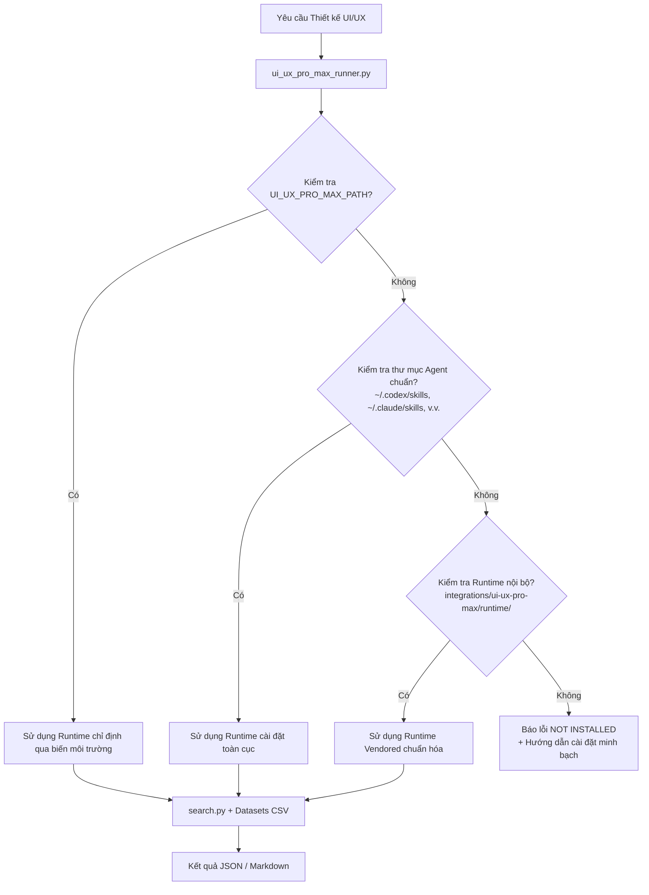

# UI/UX Pro Max Integration — DEX Engineering Skills

> **Cầu nối Trí tuệ Thiết kế (Design Intelligence Bridge) & Hệ thống Tra cứu Dữ liệu Giao diện Thực nghiệm**  
> Tích hợp từ kho mã nguồn mở [NextLevelBuilder/ui-ux-pro-max-skill](https://github.com/nextlevelbuilder/ui-ux-pro-max-skill) theo giấy phép MIT.

---

## 1. Giới Thiệu & Mục Tiêu

`dex-ui-ux-pro-max-adapter` là kỹ năng tích hợp cách ly (segregated integration) cung cấp cho các AI Coding Agent (OpenAI Codex, Claude Code, Cursor, Windsurf, VS Code) khả năng nghiên cứu, đề xuất và triển khai giao diện người dùng dựa trên cơ sở dữ liệu thiết kế thực nghiệm:

- **12 Domain Tra cứu Chuyên sâu**: `style`, `color`, `typography`, `ux`, `chart`, `landing`, `product`, `icons`, `gsap`, `react`, `web`, `google-fonts`.
- **22 Tech Stack Hỗ trợ**: React, Next.js, HTML/Tailwind, Shadcn UI, Vue, Nuxt, Svelte, Astro, SwiftUI, Flutter, React Native, Jetpack Compose, Three.js, Angular, Laravel, JavaFX, WPF, WinUI, Avalonia, Uno, UWP.
- **Tự động sinh Design System**: Tạo bảng màu, cặp phông chữ, biến CSS, quy tắc công thái học và danh sách chống chỉ định (anti-patterns) chỉ với một câu lệnh.
- **Không ảo giác**: Hoạt động trực tiếp trên engine tìm kiếm BM25 chuẩn Python (zero external pip dependencies).

---

## 2. Bản Quyền & Nguồn Gốc (Attribution & Provenance)

- **Tác giả gốc:** [NextLevelBuilder](https://github.com/nextlevelbuilder)
- **Kho upstream:** `https://github.com/nextlevelbuilder/ui-ux-pro-max-skill`
- **Pinned Commit:** `04cfb449bd8494811ad63e94172a308fa25a551a`
- **Giấy phép:** MIT License (xem tệp [`LICENSE`](LICENSE))
- **Chính sách tích hợp:** Tích hợp cách ly (Segregated Integration) đặt tại `integrations/ui-ux-pro-max/`, không làm tăng số lượng native skills (200 skills) của DEX Framework.

---

## 3. Kiến Trúc Hoạt Động & Phát Hiện Runtime (Hybrid Discovery)

Bộ điều hợp sử dụng công cụ thực thi [`scripts/ui_ux_pro_max_runner.py`](../../scripts/ui_ux_pro_max_runner.py) với 2 cơ chế phát hiện:



---

## 4. Hướng Dẫn Sử Dụng (CLI & Python API)

### 4.1 Kiểm tra trạng thái Runtime
```powershell
python scripts/ui_ux_pro_max_runner.py --status
```
*Kết quả mẫu:*
```text
=== UI/UX PRO MAX RUNTIME STATUS ===
Installed    : True
Mode         : VENDORED_LOCAL
Search Script: D:\VibeCoding\dex-engineering-skills\integrations\ui-ux-pro-max\runtime\scripts\search.py
Details      : Found in DEX approved vendored runtime: ...
```

### 4.2 Sinh toàn bộ hệ thống thiết kế (Design System)
```powershell
python scripts/ui_ux_pro_max_runner.py "fintech banking dashboard" --design-system
```

### 4.3 Tra cứu phong cách giao diện (UI Style)
```powershell
python scripts/ui_ux_pro_max_runner.py "crypto exchange" --domain style --json
```

### 4.4 Tra cứu quy chuẩn theo Tech Stack
```powershell
python scripts/ui_ux_pro_max_runner.py "responsive navbar" --stack nextjs --json
```

### 4.5 Gọi từ Python Script
```python
from ui_ux_pro_max_runner import search

# Tra cứu bảng màu
res = search("modern healthcare portal", domain="color", json_output=True)
for item in res.get("results", []):
    print(item["Palette Name"], item["Primary Colors"])
```

---

## 5. Phối Hợp với DEX Engineering Skills

Khi Master Orchestrator nhận diện một tác vụ thiết kế:

1. **`dex-ui-ux-pro-max-adapter`**: Tra cứu dữ liệu phong cách, màu sắc, font chữ và quy chuẩn stack.
2. **`dex-design-system-tokens`**: Chuyển đổi màu HEX và spacing thành CSS Variables chuẩn W3C hoặc Tailwind theme.
3. **`dex-ui-component-contracts`**: Khai báo TypeScript interface và 5 trạng thái thành phần (Default, Hover, Focus, Disabled, Loading).
4. **`dex-ux-accessibility`**: Kiểm toán WCAG 2.1 AA (độ tương phản $\ge 4.5:1$, điều hướng phím Tab, thẻ ngữ nghĩa).
5. **`dex-visual-regression`**: Đóng băng pixel snapshot và phát hiện sai lệch giao diện trước khi bàn giao.

---

## 6. Xử Lý Sự Cố (Troubleshooting)

- **Trường hợp báo `NOT INSTALLED`**:
  Kiểm tra xem thư mục `integrations/ui-ux-pro-max/runtime/` có chứa `scripts/search.py` và `data/` hay không. Hoặc gán biến môi trường:
  ```powershell
  $env:UI_UX_PRO_MAX_PATH = "C:\path\to\ui-ux-pro-max-skill"
  ```
- **Lỗi hiển thị ký tự đặc biệt trên Windows PowerShell**:
  `ui_ux_pro_max_runner.py` tự động cấu hình `sys.stdout` sang UTF-8. Nếu chạy lệnh thủ công qua PowerShell cũ, hãy bật UTF-8:
  ```powershell
  [Console]::OutputEncoding = [System.Text.Encoding]::UTF8
  ```

---

## 7. Cập Nhật Upstream & Rollback

### Kiểm tra tính toàn vẹn và đồng bộ
```powershell
python scripts/sync_upstream.py --dry-run
```

### Rollback an toàn
Nếu cần loại bỏ tích hợp hoặc quay về trạng thái trước đó, kiểm tra manifest `manifests/upstream-sources.json` và hoàn tác thông qua Git:
```powershell
git checkout feat/ui-ux-pro-max-integration -- integrations/ui-ux-pro-max/
```
